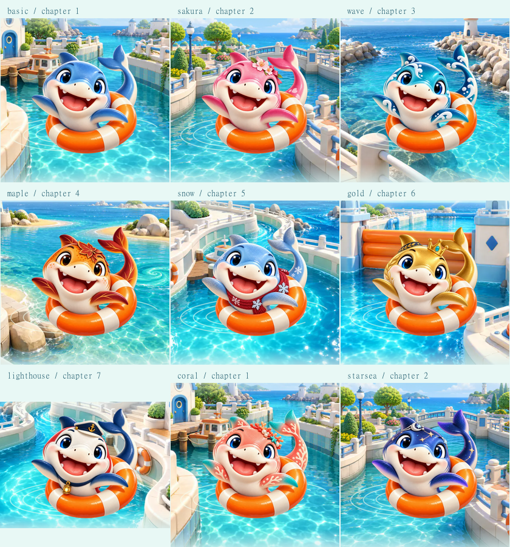

# 스킨별 구명튜브 메인 로고

2026-10-22. 기본 무태상어의 `../shark-hero.webp`를 유지하고, 기존 8종 스킨에 같은 구도의 메인 전용 그림을 추가했다. 메인에서 선택용 `portrait`를 축소해 쓰던 분기를 제거하고 각 스킨의 `hero`를 동일한 크기로 그린다.

- 제작: built-in ImageGen, 스킨당 1회씩 총 8회. 구도·얼굴·구명튜브 기준은 `../source/shark-hero.png`, 색상·장식 기준은 `../skins-v2/*-portrait.webp`.
- `source/*.png`: 생성 원본 8개, 모두 1254×1254 RGBA. 원본의 모양이나 색을 추가 가공하지 않았다.
- `*-hero.webp`: 런타임용 512×512 투명 이미지 8개, 총 455,424 bytes. 기존 기본 로고와 같은 내보내기 크기 및 WebP 품질을 사용한다.
- `prompts.json`: 각 이미지에 사용한 전체 프롬프트와 참조 경로.
- `manifest.json`: 원본/출력 SHA-256, 출력 크기·용량·알파 실루엣 범위. 내보내기에서 투명 영역과 잘림 여부를 검사한다.
- `preview.png`: 실제 브라우저의 메인 장면 9종 캡처를 모은 그림. 검사용 소유/진행 기록으로 촬영했다.

재생성된 원본을 같은 위치에 둔 뒤 `node tools/prepare-hero-skin-art.js <sharp 모듈 경로>`로 WebP와 manifest를 내보낸다. 원본 PNG와 프롬프트는 보존한다.

`tools/build-source.js`가 새 WebP를 HTML에 내장한다. `SHARK_ART`의 기존 스킨별 로딩·캐시를 재사용하며, 준비 중이거나 실패한 스킨은 기본 구명튜브 이미지로 표시한다. 첫 진입 준비 목록은 선택한 스킨의 hero를 기다린다. 기존 시작 제한 시간과 실패 시 대체 표시는 유지한다. 게임판/스킨 선택/클리어 그림과 해금 조건·저장 형식은 변경하지 않았다.

검증: art·launch·motion·development 관련 테스트 22개, 웹 빌드 및 `check-release.js www` 통과. `tools/home-scene-qa.js`로 390×844에서 9종 로딩·동작 줄이기·새로고침과 실제 벚꽃 스킨 선택→게임 진입→메인 복귀→재로딩을 확인했다. 브라우저 오류는 없었으며 [보고서](browser-report.json)에 9종/지역 조합을 남겼다. 이미지 실패와 중복 요청 방지는 단위 테스트로 확인했다. 실물 Android 검증이나 공개 배포는 수행하지 않았다.

