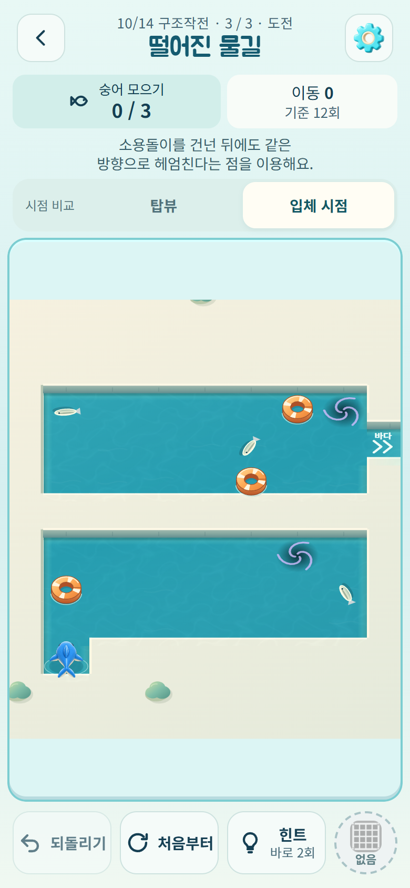
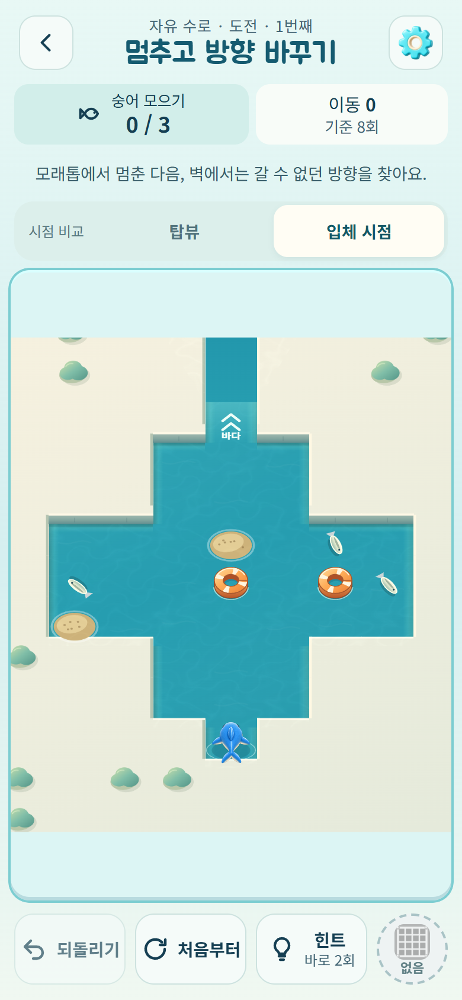

# 모든 수로에 입체 시점 적용

2026-10-14. 변경 전 `f63fc97`. [정식 게임](https://kongrae.github.io/bukang-sea/).

후속 변경: 시점 선택은 **설정 → 화면 시점**으로 이동했다. 게임판 공간 확대와 장애물/둑 겹침 수정은 [BOARD-SPACE.md](BOARD-SPACE.md)를 따른다.

정식 84개 수로에는 이미 입체 그래픽이 적용되어 있었지만 `canalComparison()`이 일일·자유·시험·이전 저장 맵을 제외했다. 준비된 게임판의 존재만 확인하도록 바꿔 모든 플레이 모드에서 기존 입체 그래픽과 시점 버튼을 사용한다.

- 정식 수로 84개
- 오늘의 구조작전 3개 수로와 이전 버전 작전/단일 일일 수로
- 자유 수로의 세 난이도와 이전 버전 진행
- 이전 정식 맵의 진행 복원과 호환 시험 코스

상어·물가·구조정·상자·수문·부표·스위치·물줄기는 각 수로에 실제 존재하는 요소만 기존 입체 그리기로 표시한다. 장치 안내 그림은 기존 방식을 유지한다. 스킨별 대체 그림 정책도 같다.

시점 선택은 기존 `bukang-first-canal-view-v1`를 그대로 쓰며 모든 모드에 이어진다. 저장된 선택이 없으면 입체 시점, 탑뷰를 선택했던 경우에는 탑뷰로 열린다. 화면의 **입체 시점** 버튼으로 언제든 바꿀 수 있다. 저장 데이터를 초기화하거나 수로를 다시 시작할 필요가 없다.

규칙·맵 생성기·해금·보상·진행 저장은 변경하지 않았다. 과거 일일/자유 수로의 그물 회수 규칙과 맵 정의도 유지했다.

## 검증

- 기존 테스트 241/241, 정식 84개와 호환 시험 12개 수로 검증 통과.
- 정식 84개 맵 렌더링/시점 전환과 대표 수로 69회 입력에서 변경 전후 상태·저장 세션 일치.
- 추가 53개 맵: 일일 v1–v4 각 3개와 이전 단일 일일 1개, 자유 v1–v4 각 세 난이도, 이전 정식 정의 16개, 호환 시험 12개. 첫 3회씩 총 159회 입력에서 이전 탑뷰와 새 입체 시점의 상태·저장 세션이 일치했다.
- 위 53개 맵의 시점 전환, 투영된 좌표의 그물 입력, 되돌리기, 저장 패킷 복원 통과. 생성형 수로는 모든 시드를 열거한 것이 아니라 지원 버전·단계별 대표 맵을 확인했다.
- 실제 출시 UI에서 일일 3단계·자유 세 난이도 메뉴 진입, 시점 전환 시 저장 바이트 유지, 새로고침 후 카메라 선택/세션 유지, 오프라인 이어하기 통과.
- 320–430px 화면, 200% 루트 글자 확대, 빠른 시점 전환, 이미지 실패, 동작 줄이기와 일반 이동 확인.
- 단일 HTML, artifact, PWA, Android debug APK 빌드 성공. 실제 Android 기기 검증은 미실시.

결과: [규칙·저장 대조](all-canal-view/regression-checks.json), [출시 UI](all-canal-view/browser-checks.json).

아래는 PC Edge 390×844 모바일 에뮬레이션의 실제 출시 UI다. 격리된 QA 기록으로 정식/일일 단계를 해금했으며 사용자 저장에는 영향을 주지 않는다.





## 재현

```text
npm test
npm run verify
npm run build
npm run build:artifact
npm run android:debug
node tools/serve.js . 5182
node tools/board-art-qa.js <playwright 경로> f63fc97 all
node tools/device-view-qa.js <playwright 경로> http://localhost:5182/www/ --all
```

`tools/deploy-pages.ps1` 배포 후 공개 버전의 커밋 및 본 게임/비교판 HTML·서비스워커 해시를 대조한다. 출시 UI 검사를 공개 URL과 `--all`로 다시 실행한다. QA 훅과 테스트 진행은 출시 빌드에 포함하지 않는다.
