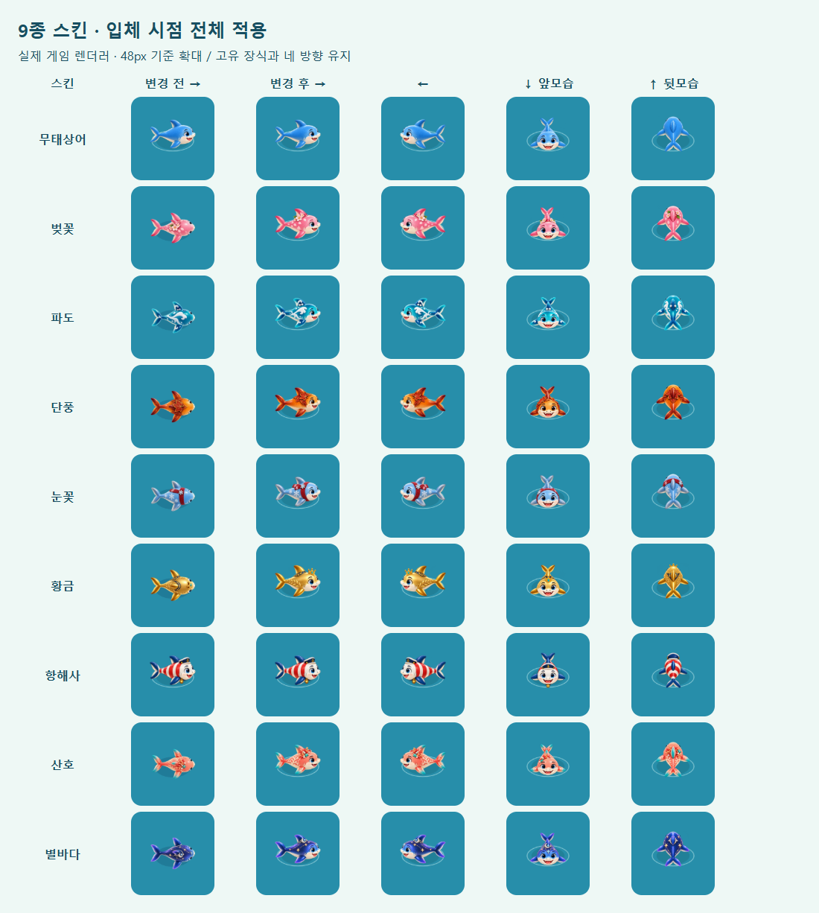

# 전체 상어 스킨 입체 그래픽

2026-10-14. 변경 전 `088a565`.

## 원인과 적용 범위

기존 입체 카메라에는 기본·항해사만 방향별 그림이 등록돼 있었다. 나머지 7종은 `getOblique()`가 null을 반환해 탑뷰 그림으로 돌아갔다. 전체 해금 검사에서 스킨 착용 여부만 확인하고 실제 그림의 일관성은 놓쳤다.

벚꽃·파도·단풍·눈꽃·황금·산호·별바다의 기존 색상과 장식을 유지한 네 방향 그림을 추가했다. 기본/항해사를 포함한 9종 모두 같은 입체 렌더 경로를 사용한다. 정식 수로·일일·자유·복원된 게임판과 장치 예시가 공통 함수를 쓴다. 탑뷰에서는 기존 탑뷰 그림을 계속 사용한다. 스킨 선택 화면의 기존 입체 초상화는 유지했다.



[실제 게임판의 벚꽃 스킨](skin-directions/game-sakura.png) · [장치 예시의 벚꽃 스킨](skin-directions/guide-sakura.png)

## 자산과 구현

- built-in ImageGen, 투명 원본 7장 추가. 각 원본은 해당 스킨의 `skins-v2/source`와 기본 스킨의 4방향 아틀라스를 참조했다. [프롬프트 전문](../assets/art/oblique-v1/skin-prompts.json).
- `tools/prepare-oblique-art.js`로 비율을 유지한 최대 256px WebP 28장 추가. 기존 8장과 함께 36장, 총 648,710 bytes. [원본과 납품 파일](../assets/art/oblique-v1/README.md).
- `src/art.js`에서 9종 방향 등록, `tools/build-source.js`에서 실제 빌드 내장. 선택된 스킨의 네 방향만 디코딩하며 실패 시 기존 대체 렌더를 유지한다.
- 맵 투영 88%와 상어 외형 역보정을 재사용한다. 이미지 회전으로 앞/뒤를 흉내 내지 않으며 프레임 루프·타이머는 추가하지 않았다.
- "이 스킨은 기존 모습으로 표시돼요" 안내는 더 이상 적용되는 스킨이 없어 제거했다.
- 게임 규칙·스테이지·스킨 ID/해금 조건·저장 스키마는 변경하지 않았다. 개발 전체 해금과 출시 빌드 차단 검사도 유지한다.

## 확인

- Node 테스트 244/244. 모든 선택 가능 스킨을 기준으로 4방향 자산/빌드 내장/지연 디코딩/재사용을 검사한다. 특정 스킨을 누락하면 실패한다.
- 정식 84개와 호환 시험 12개 수로 검증 통과.
- Edge 실제 UI에서 9종 모두 선택 → 게임판 → 장치 예시로 진입. Canvas `drawImage` 관찰로 해당 스킨의 입체 이미지가 그려졌음을 확인했다. 장치 예시 전후 진행 세션은 동일하다.
- 실제 공통 렌더러로 9종 × 4방향 × 48px/32px 검사: 이미지 디코딩, 비율 보정, 잘림 없음, Canvas 상태 복원 확인.
- 스킨을 착용한 이동·탑뷰 전환·새로고침·오프라인 입체 복원·되돌리기 통과.
- 개발 APK 및 출시 AAB 빌드. 출시는 정상 해금/개발 자산 제외 검사를 유지한다.

[브라우저 검사 기록](skin-directions/results.json). 브라우저 검증은 Edge 모바일 에뮬레이션이며 실제 Android 기기 터치·설치·Play Console 업로드는 수행하지 않았다.

```text
npm test
npm run verify
npm run build
npm run build:artifact
npm run build:web:dev
node tools/skin-direction-qa.js <playwright> http://localhost:5182/www/ --gallery
```

공개 URL을 인자로 주면 공개 페이지의 실제 UI·장치 예시·오프라인 복원을 확인한다. `--gallery`의 비교용 훅은 로컬 QA HTML에만 들어가며 배포하지 않는다. 실제 사용자의 기록을 건드리지 않는 별도 브라우저 컨텍스트에서 실행한다.
