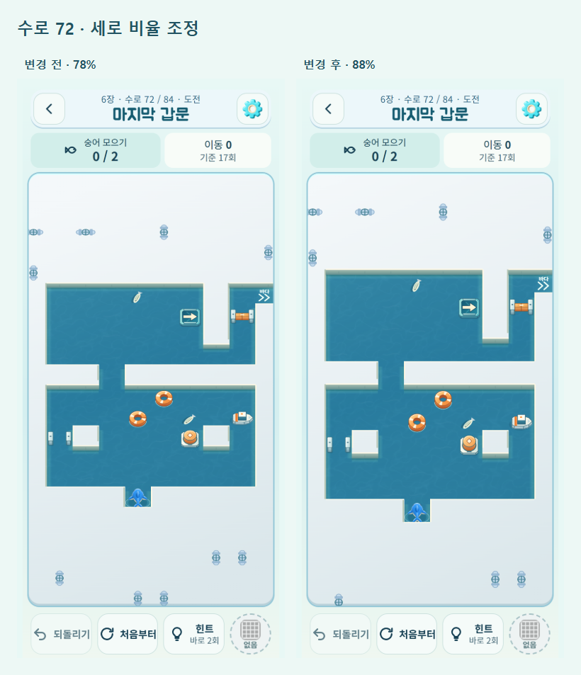

# 입체 시점 비율 점검

2026-10-14. 변경 전 `fc1fb50`.

## 원인과 조정

기존 입체 시점은 맵 전체를 세로 78%로 투영했다. 같은 칸 크기에서도 가로 대비 세로가 22% 짧아져 수로와 구조정·부표가 넓적하게 보였다. 기본·항해사 스킨의 방향별 이미지는 이미 역보정을 적용하지만, 입체 전용 이미지가 없는 7종 스킨과 이미지 실패 시 Canvas 그림에는 보정이 없었다.

실제 72번 수로에서 78/84/88/92%를 비교한 뒤 **88%**를 선택했다. 지면의 원근감과 둑·장치의 높이를 유지하면서 압축을 완화한다. 같은 칸 크기에서 지면/장치의 세로 길이는 이전보다 약 12.8% 길어진다. 좁거나 낮은 화면은 기존 투영 크기 맞춤 계산으로 판 전체를 유지한다.

`drawShark()`에 선택적인 투영 계수를 전달해 나머지 스킨과 대체 그림도 **화면에 투영된 칸 중심을 기준으로 원래 외형 비율**을 유지한다. 방향 회전 전에 보정하므로 상하좌우 모두 적용된다. 기본·항해사의 기존 보정은 그대로다. 다른 스킨에 새 입체 그림을 추가한 것은 아니다.

탑뷰·메인·장치 안내 호출은 기본값 1로 기존 모습을 유지한다. 게임판/그물 터치에는 같은 `boardProjection()`과 역투영을 사용한다. 규칙·장치 위치·진행 저장·해금·보상은 변경하지 않았다.

## 실제 렌더 비교



[첫 수로 비교](proportions/comparison-1.png) · [상어와 장치의 확대 비교](proportions/silhouettes.png)

## 검증

- `npm test` 241/241, `npm run verify` 정식 84개+호환 12개, 단일 파일·artifact·웹·Android 디버그 빌드 통과.
- 9종 스킨 × 4방향: 탑뷰 픽셀이 변경 전과 같음. 입체 전용 그림이 없는 7종은 입체/탑뷰 외형 경계가 1px 이내로 일치. 이미지가 모두 실패해도 네 방향의 대체 그림이 비율을 유지함.
- 실제 게임 그리기 호출에서 7종 모두 새 투영 계수를 전달하는지 검사. 시점 보정 후 Canvas 상태 복원 확인.
- 앞쪽 둑 가림 픽셀을 정식 84개 수로에서 재검사해 이전 겹침 수정 유지 확인. 320×568/390×844에서 판 전체가 세로 범위에 들어옴.
- 전체 렌더·입력 회귀: 정식 84개, 대표 해법 69회 입력, 생성/이전/시험 맵 53개에서 159회 입력의 상태·저장 세션이 이전과 일치. 화면 좌표의 그물 설치·되돌리기·복원·이미지 실패·모션 유지.
- 출시 UI와 별도 비교판은 실제 버튼을 통해 시점 전환·진행 복원·오프라인·작은 화면/글자 확대를 검사한다. 공개 배포 후 동일 출시 UI 검사를 반복한다.

[비율/가림 검사](proportions/results.json) · [진행 회귀](proportions/regression.json) · [출시 UI](proportions/release-local.json)

Edge 모바일 에뮬레이션과 격리된 테스트 저장 데이터로 확인했다. 실제 Android 기기 설치·물리 터치·OS 글자 확대는 미확인이다. Android 빌드는 성공했으며 기존 Gradle 폐기 예정 기능 경고가 남는다.

재현: `node tools/serve.js . 5182`를 켠 뒤 설치된 Playwright 경로를 전달한다.

```text
node tools/board-art-qa.js <playwright> fc1fb50 all
node tools/proportion-qa.js <playwright>
node tools/device-view-qa.js <playwright> http://localhost:5182/www/ --all
node tools/view-lab-qa.js <playwright>
```
