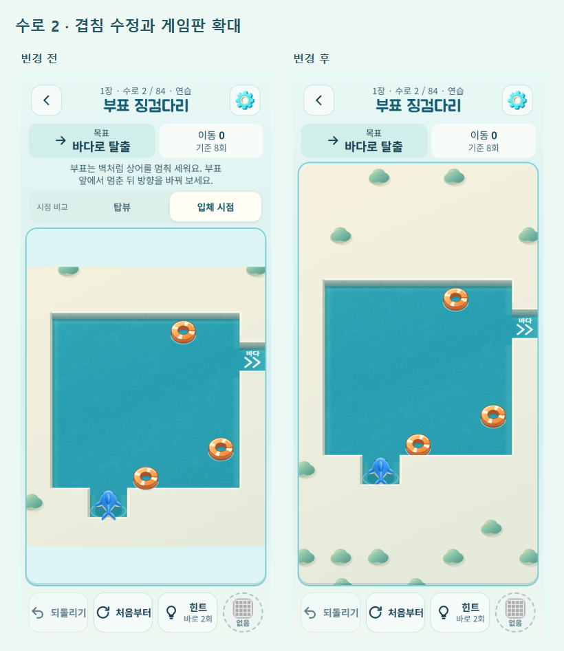

# 장애물 겹침 수정과 게임판 공간 확보

2026-10-14. 변경 전 `de442d7`. 정식 게임과 모든 수로 모드에 적용한다.

## 확인한 원인과 변경

브라우저에서 수로 2·3의 부표 밑면과 수로 79의 구조정이 앞쪽 둑 위에 겹쳐 그려지는 것을 확인했다. 입체 둑은 물 쪽으로 0.23칸 올라와 있지만 배경을 먼저 그린 다음 모든 장치를 그려서, 앞에 있어야 할 둑도 장치 뒤로 밀렸다. 구조정 방향 화살표도 바로 앞이 둑인 경우 둑 위에 표시됐다.

- 앞쪽 둑의 돌출 부분만 별도 정적 레이어로 보관해 장치와 상어 다음에 합성한다. 뒤쪽 둑 앞에 있는 물체는 가리지 않는다. 모래톱 중심·장치 중심·바다 출구는 그대로 유지한다.
- 입체 시점에서 바로 앞이 둑인 구조정의 공중 화살표는 숨긴다. 선체 방향과 이동 규칙은 그대로다.
- 게임판 위의 상시 설명과 시점 비교 영역을 제거했다. 시점 선택은 **설정 → 화면 시점**으로 옮기고 기존 선택 저장 키를 유지한다.
- 힌트·그물 오류·첫 장치 안내는 필요한 순간에만 판 아래쪽에 표시한다. 닫기 버튼이나 다음 유효 이동으로 닫히며 게임판 크기는 변하지 않는다. 안내 위 터치는 게임 입력으로 전달하지 않는다.
- 입체 투영 후 크기로 판을 맞춰 작은 화면의 칸 크기를 확보했다. 위아래 빈 띠 대신 실제 배경을 끝까지 그린다. 화면 밖 정적 배경의 원점도 기기 픽셀에 맞춰 물 타일 사이 틈을 방지한다.

게임 규칙, 레벨·생성기, 보상·해금, 진행 저장 구조는 변경하지 않았다. 화면 좌표를 게임 좌표로 바꾸는 기존 역투영을 재사용한다. 별도 `/compare/` 실험판도 공통 렌더링을 사용하며 전용 설명/선택 UI를 유지한다.

## 전후 비교



12행 수로의 브라우저 CSS 픽셀 실측:

| 화면 | 이전 게임판 높이 | 이후 게임판 높이 | 칸 크기 |
| --- | ---: | ---: | ---: |
| 390 × 844 | 535.5 | 633.9 | 38 → 38 |
| 320 × 568 | 269.7 | 380.2 | 22 → 30 |

390px에서는 가로 폭이 칸 크기를 제한하므로 세로 표시 영역이 늘어난다. 작은 화면에서는 확보한 높이와 투영 크기 계산으로 실제 칸도 커진다. 바깥 행에 있는 상어 시작 칸을 잘라서 확대하지 않는다.

[설정 화면](board-space/settings.png) · [필요할 때만 표시되는 힌트](board-space/hint.png)

## 검증

- `npm test`: 241/241 통과.
- `npm run verify`: 정식 84개 및 호환 시험 코스 12개 통과.
- `npm run build`, `npm run build:artifact`, `npm run android:debug`: 통과. Gradle의 기존 폐기 예정 기능 경고는 남아 있다.
- 렌더/진행 회귀: 정식 84개 렌더, 대표 해법 69회 입력, 생성·이전 정의·시험 맵 53개에서 159회 입력. 변경 전후 게임 상태와 저장 세션 일치, 그물의 화면 좌표 입력·되돌리기·복원·이미지 실패 대체 표시 통과. [기록](board-space/regression.json)
- 겹침 픽셀 검사: 기존 2·3·79 수로에서 문제 재현, 변경 후 84개 수로의 불투명 앞쪽 둑 픽셀 일치. 상시 두 줄 제거, 설정 이동, 힌트 표시·닫기·입력 분리, 화면 크기 실측 통과. [기록](board-space/layout-occlusion.json)
- 일반 출시 빌드의 실제 메뉴/버튼: 수로 72·84, 일일 3개·자유 3개, 시점 전환 후 저장 바이트 유지, 새로고침·오프라인 복원, 빠른 시점 전환, 320/360/390/430px와 루트 글자 200% 검사 통과. [로컬 기록](board-space/release-local.json)

위 검증은 격리된 저장 데이터를 사용하는 Edge 모바일 에뮬레이션이다. 전체 맵 반복 검사는 내부 QA 진입과 시점 이벤트 호출을 사용하고, 출시 빌드 검사는 실제 메뉴와 설정 버튼을 클릭한다. 실제 Android 기기 설치·물리 터치·OS 글자 확대는 확인하지 않았다. Android 빌드 성공과 실제 기기 확인을 구분한다.

재현 순서(로컬 정적 서버 `node tools/serve.js . 5182`, 설치된 Playwright 모듈 경로를 `<playwright>`에 전달):

```text
node tools/board-art-qa.js <playwright> de442d7 all
node tools/board-space-qa.js <playwright>
node tools/device-view-qa.js <playwright> http://localhost:5182/www/ --all
node tools/view-lab-qa.js <playwright>
```

배포 후에는 `version.json`의 커밋, 본 게임/비교판 HTML 및 서비스 워커 해시를 확인하고 공개 URL에서 `device-view-qa.js ... --all`을 다시 실행한다. 배포 확인 결과는 `outputs/qa/board-space/`, 공개 브라우저 결과는 `outputs/qa/device-view/public-results.json`에 남긴다.
