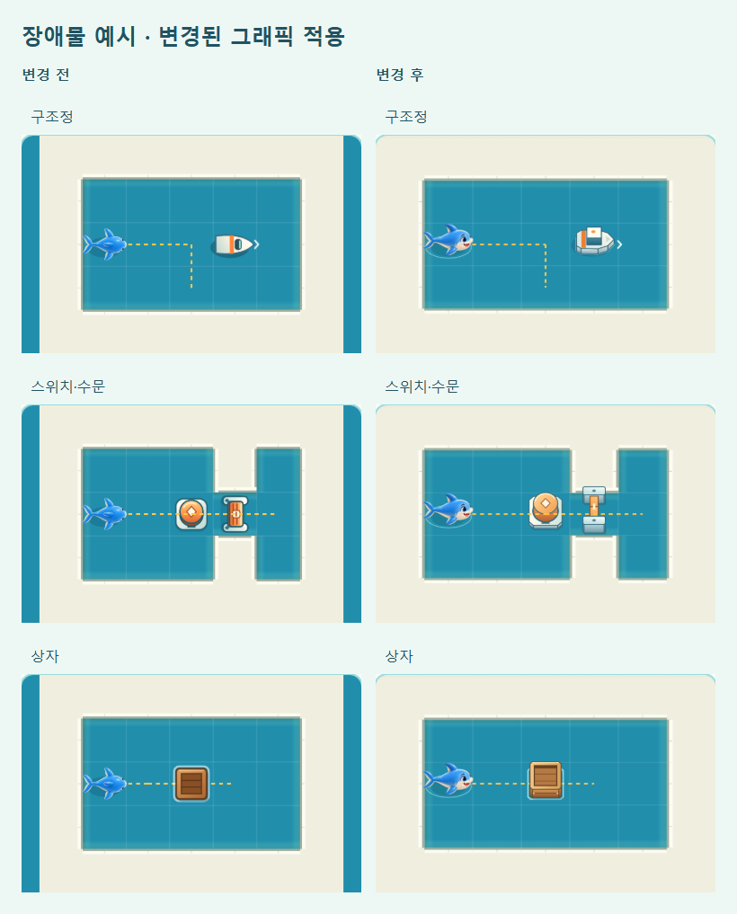

# 장치 예시 갱신과 개발 전용 전체 해금

2026-10-14. 변경 전 `042932c`.

## 장치 예시

예시와 도움말 아이콘은 이미 공통 렌더 함수를 썼지만 `raised` 인자가 없어서 탑뷰 그림만 나왔다. 저장된 시점에 맞춰 구조정·상자·수문·스위치·부표·물줄기의 입체 렌더와 88% 투영을 전달한다. 상어는 예시의 방향/좌표로 그리며 본 게임의 `view`나 게임 상태를 바꾸지 않는다. 탑뷰 선택 시 예시도 탑뷰다. 8종 설명·단계·실제 규칙 기반 재생은 그대로다.



## 빌드 선택

| 용도 | 명령 | 해금·기록 | 비교 화면 |
| --- | --- | --- | --- |
| 개발 웹 / 현재 GitHub Pages | `npm run build:web:dev` | 84 수로·9 스킨·일일 3단계 즉시 선택, 개발 기록 | 포함 |
| 개발 APK | `npm run android:debug` | 위와 같음, 별도 DEV 앱 | 포함 |
| 정상 해금 웹 | `npm run build:web` | 기존 정상 해금·정식 기록 | 제외 |
| 출시 AAB | `npm run android:release` | 정상 해금 웹 재생성 → 복사 → 검사 → 서명 빌드 | 제외 |

자유 수로는 원래 세 난이도 모두 선택 가능하다. 호환 시험 수로도 개발 빌드에서는 모두 열리지만 정상 메뉴 구조는 바꾸지 않는다. 별 252개나 클리어 기록을 만들어 넣지 않으며 처음 개발 기록의 완료 수·별은 0이다.

해금 변환은 빌드 도구에만 있다. 정식 `src/game.js`의 해금 규칙은 유지하며, 출시 게임에는 개발 모드 URL이나 사용자용 토글이 없다. 개발 페이지 하단에는 `DEV · 전체 해금 · 기록 별도`가 표시된다.

개발 저장 키는 `bukang-sea-development-v1`, 시점은 `bukang-development-camera-v1`이다. 정식 `bukang-sea-v1`, `bukang-first-canal-view-v1`는 읽거나 덮어쓰지 않는다. 개발 진행은 다음 개발 빌드에도 유지되지만 정식 진행으로 옮기지 않는다. 기존 정식 기록이 사라진 것은 아니며 정상 빌드에서 다시 사용한다. 기존 별도 관찰용 `playtest`의 저장 정책도 유지한다.

Android 디버그 ID는 `kr.hongrae.sharksos.dev`, 표시 이름은 **상어 SOS DEV**, 버전에는 `-dev`가 붙는다. 출시 ID `kr.hongrae.sharksos`는 유지하므로 개발 앱과 별도로 설치된다. 실제 기기 공존 설치는 아직 확인하지 않았다.

## 출시 파일에 섞이지 않도록 하는 검사

1. `android:release`는 개발용 `www/`를 재사용하지 않고 정상 웹을 다시 만든다. 이전 개발 비교 폴더도 제거한다.
2. `build-info.json`의 모드와 실제 HTML SHA-256, 정상 저장/해금 코드, 전체 HTML/JS/JSON의 개발·관찰·QA 표식을 검사한다.
3. Capacitor 복사 후 Android의 실제 `assets/public`을 다시 검사한다.
4. Gradle의 `preReleaseBuild`에도 같은 검사를 연결해 Android Studio 직접 빌드 경로를 확인한다. 개발 자산이면 빌드가 실패한다.

따라서 출시할 때 해금 코드를 직접 지우지 않는다. `npm run android:release`로 생성한 `android/app/build/outputs/bundle/release/app-release.aab`를 사용한다. 버전 번호/서명/실기기 검증 등 기존 출시 절차는 [RELEASE.md](RELEASE.md)를 따른다. AAB 빌드는 업로드나 출시 승인이 아니다.

## 확인 결과

- 테스트 243/243, 정식 84개+호환 12개 규칙 검증 통과.
- 개발 APK / 정상 AAB 모두 빌드 성공. APK 내부 모드는 development, AAB 내부는 release이며 AAB에 비교 화면 없음. APK manifest에서 `.dev` ID와 `상어 SOS DEV` 확인.
- 개발 자산을 둔 채 직접 Gradle `preReleaseBuild` 실행 → 의도한 오류로 차단. 이후 `android:release` → 정상 자산 검사와 AAB 생성 성공.
- 실제 개발 UI: 7장 84개 선택 가능, 84번 진입, 스킨 9종 모두 착용, 일일 3단계 바로 시작, 새로고침/오프라인 복원 통과. 정식 저장/시점 키는 바이트 단위로 동일.
- 같은 브라우저에서 정상 빌드로 이동 → 정식 기록의 잠금/보유만 표시. 개발 기록과 `?all=1&dev=1`로도 정식 잠금이 해제되지 않음.
- 장치 안내 8종의 재생 단계, 입체 장치/아이콘 호출, 탑뷰 전환, 게임 상태 미변경, 320px/글자 200% 확인. 정상 출시 UI의 후반 수로·일일·자유 수로 이어하기/되돌리기/오프라인 검사 통과.

[개발/출시 UI 기록](development/release-separation.json) · [장치 예시 검사](development/guide-results.json) · [출시 진행 회귀](development/release-regression.json) · [APK/AAB 내부 모드](development/android-builds.json)

[전체 수로 선택 화면](development/all-stages.png) · [전체 스킨 선택 화면](development/all-skins.png)

브라우저 검증은 Edge 모바일 에뮬레이션이다. 실기기 설치·터치·Play Console 업로드는 수행하지 않았다. Gradle의 기존 폐기 예정 기능 경고는 남아 있다.

```text
node tools/development-qa.js <playwright> http://localhost:5182/www/
node tools/board-art-qa.js <playwright> 042932c capture
node tools/guide-art-qa.js <playwright>
```

첫 명령의 로컬 정상 빌드 전환 검사는 `outputs/qa/development/release/`에 미리 복사한 `build:web` 결과를 사용한다. 공개 URL 인자를 주면 개발 UI/기록 격리/오프라인을 검사한다. 실제 사용자의 저장소와 분리된 브라우저 컨텍스트다.
