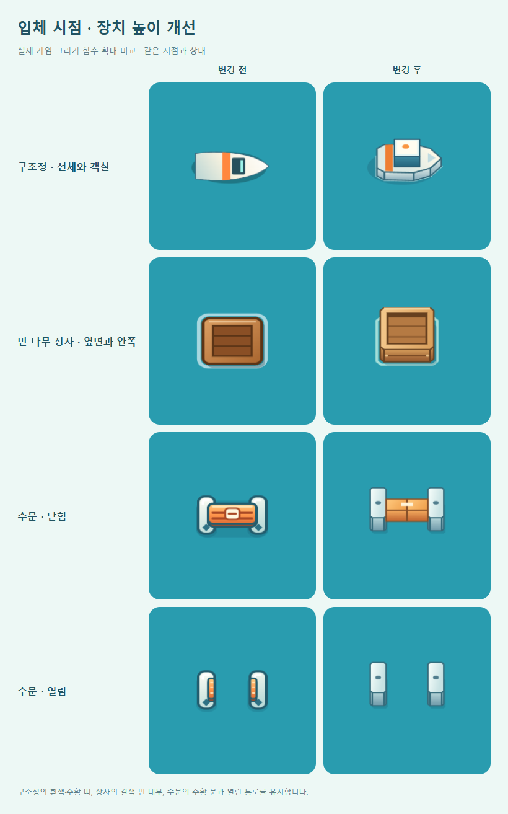
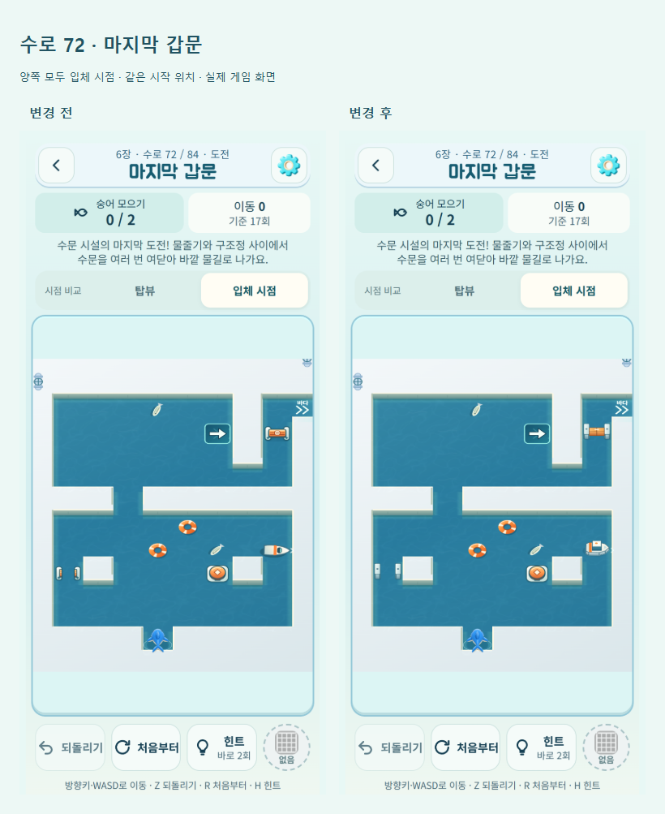
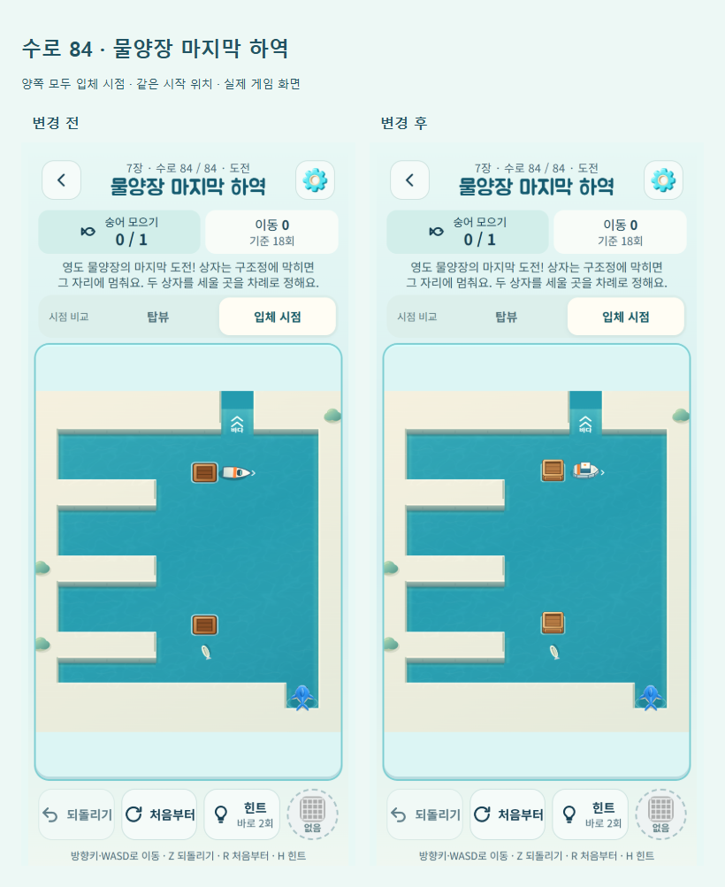

# 입체 시점의 구조정·상자·수문

2026-10-14. 변경 전 기준: `5caa2ef`. 정식 게임: https://kongrae.github.io/bukang-sea/

후속 부표·스위치·물줄기 개선과 비교는 [WATER-DEVICE-DEPTH.md](WATER-DEVICE-DEPTH.md)에 기록했다. 아래 캡처는 구조정·상자·수문을 변경한 당시 기록이다.

## 변경

이전에는 입체 카메라에서도 장치를 탑뷰용 그림 그대로 세로 압축해 높이가 거의 드러나지 않았다. 입체 시점에서만 기존 Canvas 그리기 함수에 높이와 면을 추가했다.

| 장치 | 입체 표현 | 유지한 구분과 상태 |
|---|---|---|
| 구조정 | 선체 측면, 높은 유리 객실, 밝은 지붕, 작은 표지등, 수면 그림자 | 흰 선체·주황 띠·뾰족한 뱃머리, 다음 진행 방향의 화살표 |
| 나무 상자 | 두꺼운 테두리, 안쪽 벽과 낮은 바닥, 앞면 판자와 모서리 | 갈색의 빈 사각 상자, 제자리 흔들림과 밀려가는 위치 |
| 수문 | 높이가 있는 기둥, 두께가 있는 주황 문, 부드러운 면 음영 | 닫힘은 통로를 막는 두 문, 열림은 물이 보이는 빈 통로 |

장치의 평면 방향만 회전하며 높이는 항상 화면 위쪽으로 올라간다. 수문의 앞 기둥이 열린 가로 통로 중심을 덮지 않도록 높이를 조정했다. 기둥 사이를 가로지르는 장식은 추가하지 않았다.

`drawBoat`, `drawCrate`, `drawGate`의 선택 인수 `raised`는 기본값이 false다. 정식 게임의 입체 카메라만 true를 전달하므로 탑뷰·장치 안내는 기존 그림을 사용한다. 구조정이 움직이는 시점, 상자가 미끄러지는 단계, 스위치와 수문 상태, 배가 머무는 동안 수문을 열어 두는 처리는 기존 렌더링 순서를 그대로 따른다.

규칙 엔진, 수로 정의, 저장 키·형식, 해금·보상은 변경하지 않았다. 시점 선택과 플레이 진행도 기존대로 이어진다. 새 이미지 다운로드나 라이브러리 없이 Canvas 도형만 사용한다.

## 확인 위치와 비교

메인 → 수로 선택 → **6장 수로 72 ‘마지막 갑문’** 또는 **7장 수로 84 ‘물양장 마지막 하역’** → **입체 시점**. 기존에 해금한 정식 수로 전체에 적용된다.

아래는 실제 게임의 그리기 함수를 같은 시점·상태로 확대한 비교다.



실제 보드 캡처는 같은 시작 위치에서 비교했다. Edge 390 × 844 모바일 에뮬레이션이며, 후반 수로 접근은 격리된 QA 저장을 사용했다.





## 검증

- `npm test`: 241/241 통과. 이동·구조정·상자·수문 연출 순서, 저장/진행 복원 등 기존 회귀 검사 포함.
- `npm run verify`: 정식 84개와 이전 시험 12개 수로의 해법·별 기준 통과.
- 변경 전후 84개 맵 렌더링과 시점 전환 검사. 대표 7개 수로의 69회 입력에서 게임 상태와 저장 세션이 일치했다.
- 별도 Canvas 픽셀 검사: 수문의 두 축에서 닫힌 문은 중심을 가리고, 열린 문은 중심이 투명하며 주황 문이 남지 않는다. 중간 열림에서도 문이 표시된다.
- 구조정의 네 방향에서 화살표가 뱃머리 앞에 표시된다. 장치가 인접 칸 중심을 덮지 않고 Canvas 변환을 복원한다.
- 탑뷰와 안내용 기본 호출 10개 표본이 변경 전과 픽셀 단위로 동일하다. 동작 줄이기에서 t=0과 t=7의 입체 장치가 동일하다.
- 정식 UI 검사: 72/84번 메뉴 진입·시점 전환·진행 복원·되돌리기, 320–430px 화면·글자 확대, 빠른 시점 입력, 서비스워커 오프라인 이어하기 확인.
- 단일 HTML·artifact·PWA 및 Capacitor Android debug APK 빌드 성공.

결과 파일: [장치 픽셀 검사](device-depth/pixel-checks.json), [규칙·저장 대조](device-depth/regression-checks.json), [정식 UI 검사](device-depth/browser-checks.json). 전체 상태와 원본 캡처는 `outputs/qa/board-art/`, `outputs/qa/device-depth/`, `outputs/qa/device-view/`에 있다.

**확인 경계:** PC Edge와 Android 빌드까지 확인했다. 실제 Android 기기의 터치·OS 글자 확대·앱 복귀·저사양 프레임은 미확인이다. 자동 검사로 사람의 장치 인지나 퍼즐 재미를 판단하지 않는다.

## 재현

```text
npm test
npm run verify
npm run build
npm run build:artifact
npm run android:debug
node tools/serve.js . 5182
node tools/board-art-qa.js <기존 playwright 경로> 5caa2ef devices
node tools/device-depth-qa.js <기존 playwright 경로>
node tools/device-view-qa.js <기존 playwright 경로>
```

배포는 `tools/deploy-pages.ps1`. 이후 공개 `version.json`의 커밋 및 HTML/서비스워커 해시를 로컬 빌드와 비교하고, 공개 URL에서 `device-view-qa.js`를 다시 실행한다. 배포 빌드에는 QA 훅이나 해금 fixture를 넣지 않는다.
