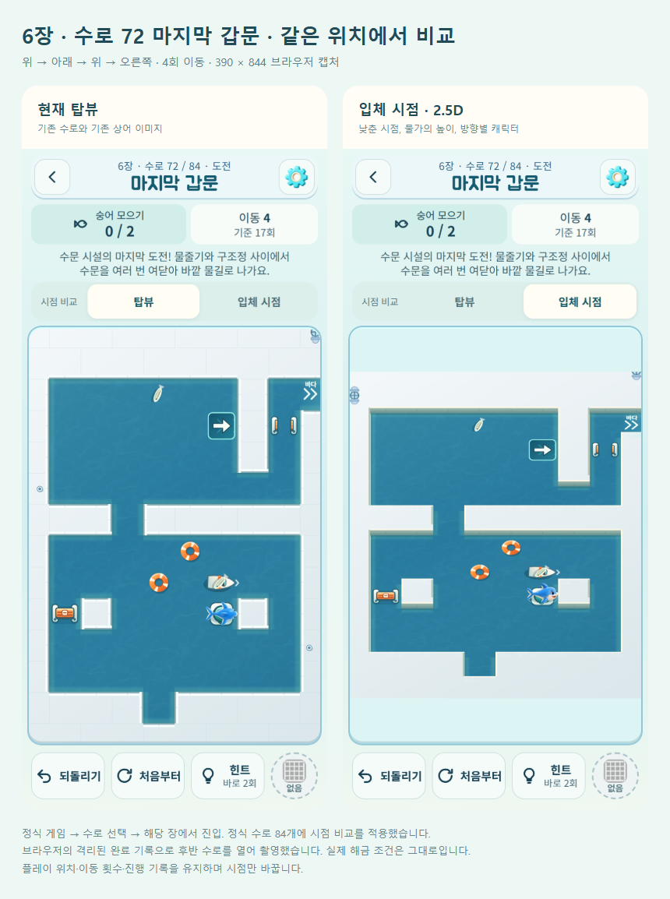
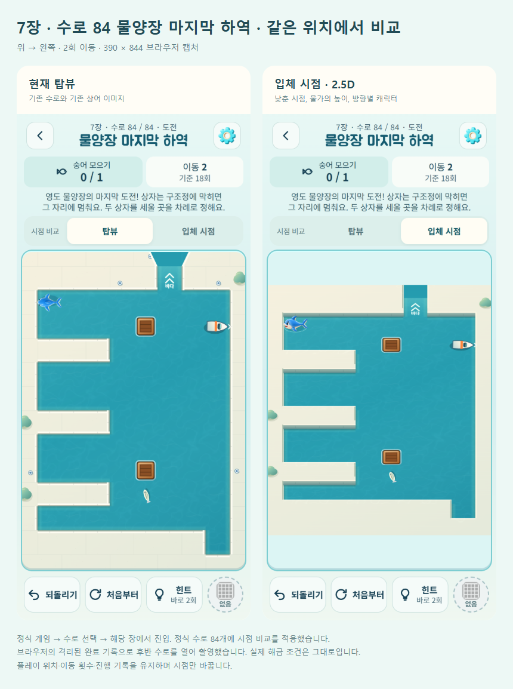

# 정식 전체 수로 · 탑뷰 / 입체 시점 비교

2026-10-14. 정식 게임: https://kongrae.github.io/bukang-sea/

## 적용 위치

정식 수로 **84개 모두**에서 게임 설명 아래의 **시점 비교 → 탑뷰 / 입체 시점**을 누른다. 첫 수로뿐 아니라 현재 이어 하던 정식 수로에서도 바로 전환할 수 있다.

장치가 많은 대표 비교 위치:

| 메인 → 수로 선택 | 이름 | 확인할 요소 |
|---|---|---|
| 6장 수문 시설 → 수로 72 | 마지막 갑문 | 열린/닫힌 수문, 스위치, 구조정, 물줄기, 부표 |
| 7장 영도 물양장 → 수로 84 | 물양장 마지막 하역 | 나무 상자 두 개, 구조정, 물고기 |
| 5장 북항 바깥길 → 수로 60 | 먼바다 가는 길 | 모래톱, 소용돌이, 물줄기, 부표, 그물 |

해금된 수로에만 기존 조건대로 진입한다. 일일 도전·자유 수로·이전 시험 코스와 별도 과거 정의로 복원되는 맵의 카메라는 이번 범위에 포함하지 않았다.

## 원인과 변경

- 기존 `37330b9`는 시점 버튼을 정식 첫 수로에만 허용했다. 현재 정식 맵인지 확인하는 조건으로 확장했다.
- 첫 수로용 입체 배경은 정적 레이어 전체를 다시 칠했다. 다른 수로에 적용하면 모래톱과 지역 색을 덮을 수 있어, 물가만 높이고 기존 바다·출구를 보존하도록 수정했다. 모래톱은 물가 다음에 그려 항상 드러난다.
- Canvas의 기존 0.78 세로 투영과 물가 높이, 방향별 상어를 재사용한다. 수문·스위치·배·상자의 상태 표시와 이동 순서는 그대로다. 별도 게임 엔진이나 3D 라이브러리는 추가하지 않았다.
- 기존 시점 저장 키 `bukang-first-canal-view-v1`를 유지한다. 첫 수로에서 탑뷰를 골랐다면 다른 수로에도 그 선택이 이어진다. 진행 키 `bukang-sea-v1`, 맵 정의, 규칙, 별·보상·해금은 수정하지 않았다.
- 기본/항해사 스킨은 네 방향 입체 그림을 사용한다. 다른 스킨과 이미지 실패 시에는 기존 그림을 유지한다. 시점 전환으로 스킨을 지급하거나 바꾸지 않는다.

## 실제 화면 비교

정식 release 화면, Edge 390 × 844 모바일 에뮬레이션. 후반 수로 접근만 격리된 완료 기록 fixture를 사용했다. 공개 게임에 테스트용 해금이나 관찰 함수를 넣지 않았다. 각 쌍은 동일한 위치와 이동 횟수다.





## 검증

| 구분 | 결과 |
|---|---|
| 단위·회귀 테스트 | 241/241 통과. 전체 수로의 입체 물가가 장치 칸 중심을 덮지 않는 회귀 테스트 포함 |
| 수로 검증 | 정식 84개 + 이전 시험 12개 해법·별 기준 통과 |
| 전체 렌더링 | 변경 전후 84개 로드, 변경 후 84개 모두 양쪽 시점과 저장 무변경 확인 |
| 실제 규칙 대조 | 변경 전 `37330b9`와 7개 대표 수로 69회 입력의 상태·저장 세션 완전 일치. 첫 탈출·그물·모래·소용돌이·수문/배/물줄기·상자 포함 |
| 입력·진행 | 실제 화면 좌표로 그물 설치, 이동 중 시점 전환, 이전 세션 복원 통과 |
| 정식 메뉴 | 메인 → 수로 선택 → 72/84번 → 양쪽 시점 → 새로고침/이어하기 → 되돌리기 통과 |
| 작은 화면·글자 | 장치 수로 320/360/390/430px, 320/390px에서 루트 글자 200%, 44px 이상 시점 버튼과 12행 보드 유지 |
| 빠른 입력·실패 | 빠른 시점 전환, 첫 수로 이동 중 뒤로가기, 이미지 실패 대체, 동작 줄이기 통과 |
| 오프라인 | 수정하지 않은 release 서비스워커로 72번 이어하기와 시점 전환 통과 |
| 빌드 | 단일 HTML, artifact, PWA, Capacitor Android debug APK 성공 |

브라우저 결과: [정식 UI 검사](device-view/browser-checks.json), [변경 전후 비교 요약](device-view/regression-checks.json). 전체 상태 원본은 `outputs/qa/board-art/devices-checks.json`에 보관한다.

PC Edge의 모바일 에뮬레이션과 Android 빌드를 구분한다. 실제 Android 기기의 터치·OS 글자 확대·백그라운드 복귀·저사양 프레임은 이번에 확인하지 않았다. 자동 해법 일치는 사람이 장치를 쉽게 읽는다는 증거를 대신하지 않는다.

## 재현

```text
npm test
npm run verify
npm run build
npm run build:artifact
npm run android:debug
node tools/serve.js . 5182
node tools/board-art-qa.js <기존 playwright 경로> 37330b9 devices
node tools/first-canal-qa.js <기존 playwright 경로>
node tools/device-view-qa.js <기존 playwright 경로>
node tools/view-lab-report.js <기존 playwright 경로> --devices
```

배포는 `tools/deploy-pages.ps1`. 배포 후 `version.json`의 커밋과 HTML/서비스워커 해시를 로컬 빌드와 대조하고 `device-view-qa.js`에 공개 URL을 전달해 정식 메뉴를 재확인한다.
