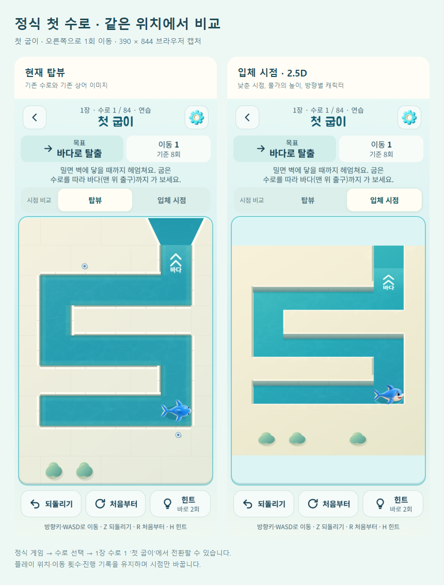

# 정식 첫 수로 · 탑뷰 / 입체 시점

2026-10-14. 정식 게임 주소: https://kongrae.github.io/bukang-sea/

후속 작업에서 정식 수로 84개 전체로 확장했다. 현재 범위와 장치 수로 검증은 [DEVICE-VIEW.md](DEVICE-VIEW.md)를 따른다. 아래는 첫 수로 도입 당시의 기록이다.

## 찾아가는 위치

메인 → **수로 선택 → 1장 북항 수로 → 수로 1 ‘첫 굽이’**. 게임 설명 바로 아래에 **시점 비교 / 탑뷰 / 입체 시점** 버튼이 보인다. 신규 실행의 구출 시작으로 첫 수로에 들어가도 같은 버튼이 나온다. 이미 진행한 사용자는 이어하기가 다른 수로를 열 수 있으므로 수로 선택에서 첫 수로를 고르면 된다.

최초 기본값은 입체 시점이다. 선택은 `bukang-first-canal-view-v1`에 기억하고 정식 진행 저장 키 `bukang-sea-v1`에는 넣지 않는다. 플레이 중 전환해도 현재 위치·이동 수·되돌리기 이력·진행 저장은 바뀌지 않는다. 메인으로 돌아왔다가 재진입하거나 새로고침 후 이어하기를 해도 진행과 시점을 유지한다.

## 구현 범위

- 기존 비교판의 물가 높이·0.78 세로 투영·방향별 상어 그림을 `src/game.js`의 정식 Canvas 렌더링에 통합했다. 같은 입력·이동 보간·프레임·클리어·진행 복원을 사용한다.
- 현재 정식 첫 수로만 적용한다. 두 번째 이후 수로, 일일·자유·이전 시험 코스, 별도 정의의 과거 맵에는 원래 카메라를 유지한다.
- 기본·항해사(내부 ID `lighthouse`) 스킨은 기존에 생성한 네 방향 이미지를 사용한다. 다른 스킨은 현재 장착한 모습을 유지하며 비교 줄에 안내한다. 스킨을 강제로 바꾸거나 해금하지 않는다.
- `SHARK_ART`의 이미지 캐시·실패 대체 그림을 재사용한다. 방향별 이미지는 빌드에 내장되지만 첫 화면 로딩 완료를 기다리는 필수 자산에 포함하지 않고, 입체 시점을 그릴 때만 해당 스킨을 디코딩한다.
- 수로 탭 좌표에도 같은 역투영을 적용한다. 벽의 아래쪽은 원래 충돌 경계를 유지한다. 그물이나 장치 규칙은 변경하지 않는다.
- 기존 `/compare/`는 공통 렌더러를 사용하도록 바꿨다. 독립된 그림·카메라 구현을 두 벌 유지하지 않는다. 이 페이지의 카메라 저장도 정식 게임과 별도다.
- 한글 라벨의 글꼴 서브셋과 standalone/artifact/PWA 빌드를 갱신했다. Android debug APK도 빌드했다.

## 실제 화면

390×844 Edge, 같은 위치에서 오른쪽 한 번 이동 후 시점만 바꾼 캡처다.



## 검증 결과

| 확인 | 결과 |
| --- | --- |
| 기존 테스트 + 카메라 회귀 | 240/240 통과 |
| 정식/기존 시험 수로 풀이 검증 | 84 + 12개 통과 |
| 전체 수로 브라우저 렌더 | 전후 각각 84개, 오류 없음 |
| 이동·진행 전후 대조 | 첫 탈출/그물/수문·구조정·물줄기/상자에서 32개 동일 입력의 상태와 저장 세션 일치 |
| 첫 수로 전환 | 탑뷰/입체 간 위치·이동·이력·저장 문자열 동일 |
| 메인 왕복/새로고침 | 이어하기로 진행과 선택한 시점 복원, 되돌리기 정상 |
| 이동 중 연속 입력 | 시점 변경·20회 빠른 이동/전환·이동 중 뒤로가기 정상 |
| 정상 클리어/다음 수로 | 6회 이동으로 별 3개; 다음 수로는 탑뷰이며 비교 버튼 없음 |
| 수로 목록 접근 | 메인 수로 선택에서 첫 굽이 진입 및 비교 버튼 확인 |
| 스킨 | 장착된 항해사·산호 스킨 유지; 해금 목록 및 진행 저장 불변 |
| 화면 | 320×568, 390×844, 430×932, 루트 글자 크기 200%, 동작 줄이기 확인; 비교 버튼 최소 44px |
| 이미지 실패 | 실패를 주입해도 기존 Canvas 상어 대체 그림과 조작 유지 |
| 실제 PWA | 수정하지 않은 release HTML을 서비스워커로 캐시, 오프라인 새로고침 후 첫 수로 이어하기 및 시점 전환 통과 |
| 빌드 | standalone, artifact, PWA, Capacitor 동기화, Android debug APK 통과 |
| 기존 비교판 | 두 스킨/두 카메라/오프라인/메인 캐시 보존 회귀 통과 |

첫 수로 집중 테스트는 release HTML에 읽기 전용 관찰 함수를 주입한 격리된 브라우저에서 실제 버튼·키보드로 수행한다. 서비스워커/오프라인 검사는 주입하지 않은 release 파일을 사용한다. 전체 수로 대조는 기존 `board-art-qa.js`의 격리된 테스트 빌드 기준이다. 정식 배포에는 관찰 함수를 넣지 않는다.

**확인 경계:** PC Edge 검증 및 Android 빌드까지 수행했다. 실제 Android 기기에서 터치·백그라운드 복귀·OS 글자 확대·저사양 프레임은 확인하지 않았다. 이번 범위는 첫 수로로, 장치가 많은 수로의 입체 그래픽은 적용하지 않았다.

## 재현

```powershell
npm test
npm run verify
npm run build
npm run build:artifact
npm run android:debug
node tools/serve.js . 5182
node tools/first-canal-qa.js <기존-playwright-모듈-경로>
node tools/board-art-qa.js <기존-playwright-모듈-경로> ac4072d check
node tools/view-lab-qa.js <기존-playwright-모듈-경로>
node tools/view-lab-report.js <기존-playwright-모듈-경로> --first-canal
```

캡처·실행 결과는 `outputs/qa/first-canal/`, 주요 캡처와 검증 요약은 `docs/first-canal/`. 배포 뒤 공개 `version.json`의 sourceCommit과 메인 HTML·서비스워커 해시를 로컬 결과와 대조하고, 공개 메인 → 수로 선택 → 첫 수로에서 버튼을 다시 확인한다.
