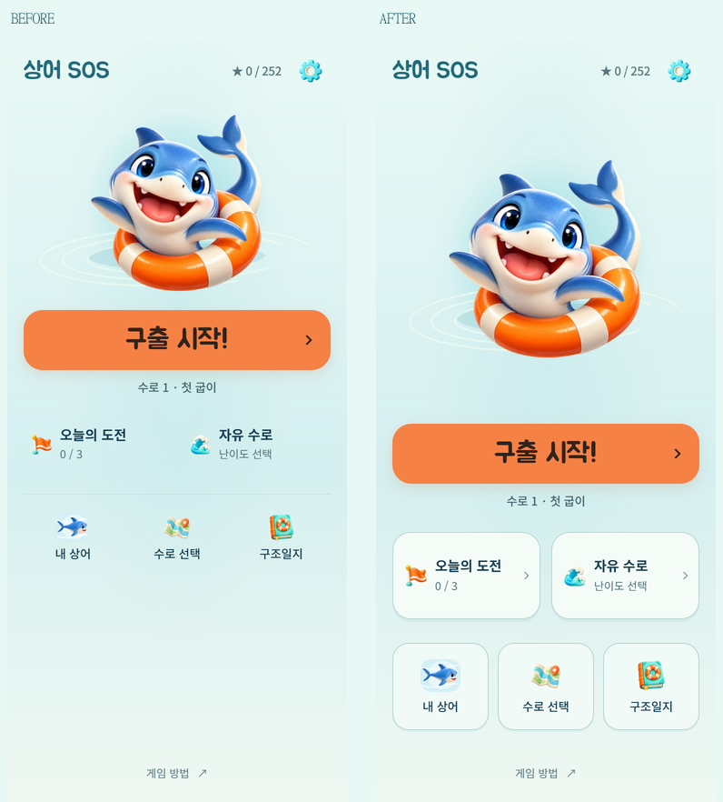

# 메인 배치 균형과 버튼 구분

2026-10-15. 변경 전 `145aa14`. [메인 간소화](HOME-SIMPLE.md) 이후 하단이 비어 보이고 보조 메뉴가 버튼처럼 보이지 않는다는 피드백을 반영했다.

후속 시각 개선: 이 배치를 유지하며 [상어 주변에 현재 여정의 바다 장면](HOME-SCENE.md)을 추가했다.

## 원인과 변경

실제 390×844 브라우저 화면에서 하단 메뉴와 게임 방법 사이에 **208px**의 빈 영역이 있었다. 소스의 `home-help: margin-top: auto`가 여유 공간을 그 사이에 몰아넣고 있었고, 메뉴의 배경·테두리가 모두 없어 클릭 영역이 불분명했다.

- 캐릭터 영역이 남는 높이를 나눠 쓰도록 flex 배치를 바꿨다. 구출 시작→현재 수로→두 모드→세 보조 메뉴 순서를 유지하며 화면 전체에 고르게 배치한다. 하단 메뉴와 게임 방법의 간격은 **25px**로 줄었다.
- 구출 시작은 기존 주황색·큰 글씨·66px 높이를 유지한다. 보조 버튼은 옅은 아이보리/청록 배경, 얇은 테두리와 낮은 그림자로 구분한다.
- 오늘의 도전·자유 수로에는 작은 이동 화살표를 추가했다. 내 상어·수로 선택·구조일지도 각각 독립된 버튼으로 표시한다. 반복 설명이나 새 기능은 추가하지 않았다.
- 누르는 동안 배경이 진해지고 작게 눌리는 반응을 제공한다. 기존 눌림 시간·키보드 포커스·동작 줄이기를 사용한다.
- 짧은 화면은 캐릭터·간격·보조 버튼 높이를 줄인다. 글자를 크게 한 상태와 가로 화면은 필요한 본문 스크롤을 허용한다.

## 검증

- 320×568, 360×640, 390×844, 412×915에서 주요 시작과 모든 메뉴가 스크롤 없이 표시되며 가로 넘침이 없다. 844×390 및 320×568 글자 200%는 스크롤로 모든 버튼에 접근할 수 있다. 글자 확대는 브라우저 모사다.
- 실제 포인터 누름에서 배경·크기 변화, 일곱 메뉴 열기/뒤로가기, 시트 드래그 닫기, 수로 목록 스크롤 복원을 확인했다.
- 빠른 시작 입력, 실제 한 칸 이동→메인→새로고침→이어하기, 첫 수로 풀이→별 저장→다음 수로, 완료 저장 fixture의 엔딩 진입, 동작 줄이기, 이미지·글꼴 실패를 확인했다. [브라우저 보고서](home-balance/report.json).
- `npm test` 267/267, 정식 84개·시험 12개 verify 통과. standalone/artifact와 Android DEV debug APK·서명 release AAB 빌드 성공.
- 변경은 메인 CSS와 QA 재사용 설정에 한정했다. 게임 규칙·진행·저장 형식·해금·별 연출·사운드 코드는 그대로다.

공개 GitHub Pages는 기존 DEV 모드로 배포하고 커밋/파일 해시·실제 화면·오프라인 이어하기를 별도 확인한다. 이번 작업에서 물리 Android 기기 터치·OS 글꼴 확대는 확인하지 않았다.

재현: `node tools/serve.js . 5182`를 실행하고, PowerShell에서 `$env:HOME_QA_BASELINE='145aa14'`, `$env:HOME_QA_NAME='home-balance'` 설정 후 `node tools/home-simple-qa.js <playwright 모듈 경로>`를 실행한다. 이전 비교 파일을 덮어쓰지 않고 같은 QA 흐름을 재사용한다.
