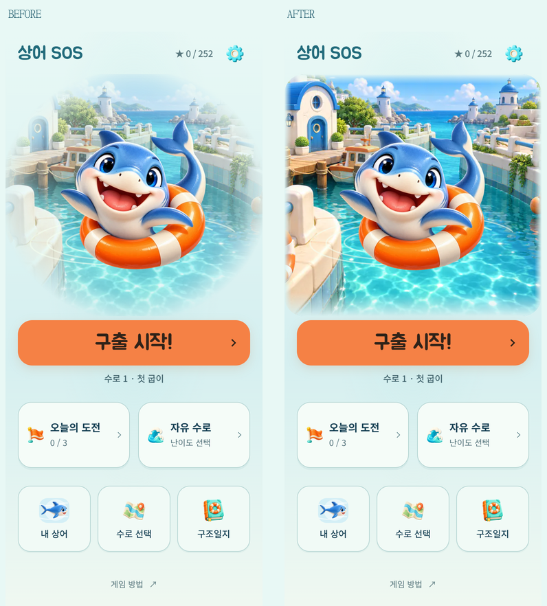
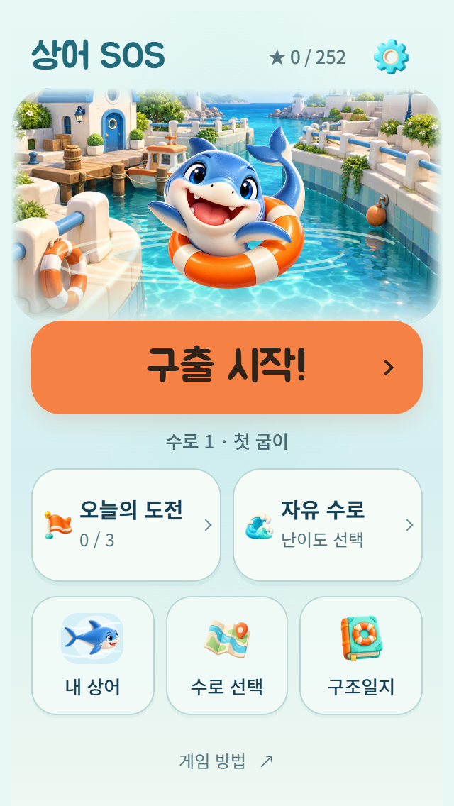
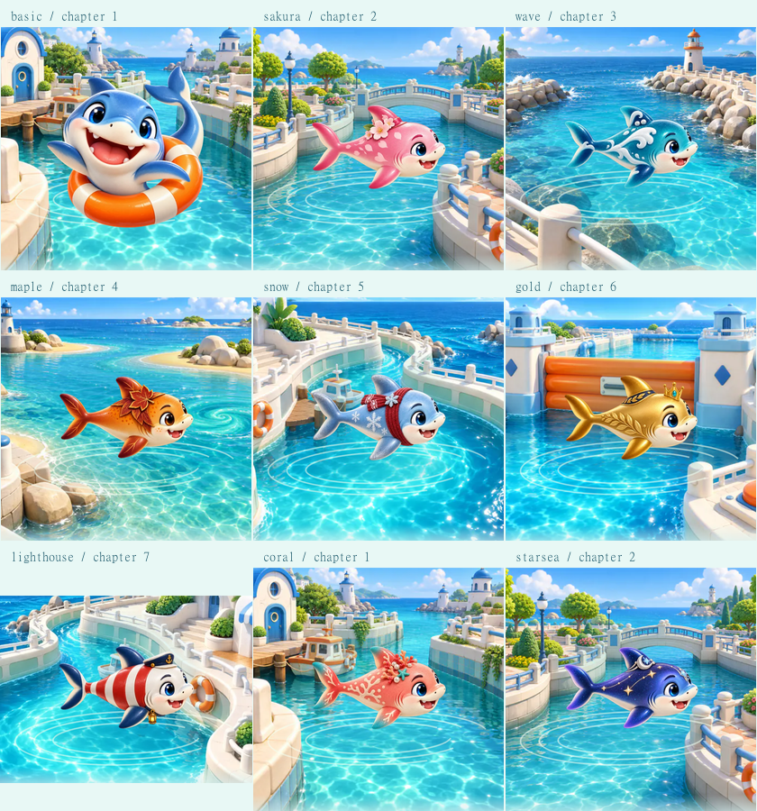

# 메인 배경 가장자리 선명도

2026-10-15. 변경 전 `6aca1c5`. [메인 바다 장면](HOME-SCENE.md)의 색과 경계만 조정했다.

실제 화면에서 항구의 건물과 물결이 가장자리의 넓은 흰 영역에 묻혔다. 소스에 blur는 없었으며, 넓은 타원형 투명 마스크에 이미지 불투명도 0.76·채도 0.82가 겹치는 것이 원인이었다.

- 이미지의 원래 색과 불투명도를 복원했다. 상단 14px·좌우 10px·하단 34px의 좁은 범위만 화면 배경색에 연결하고 모서리는 부드럽게 정리했다. 별도 테두리나 그림자는 추가하지 않았다.
- 주황색 구출 시작 버튼과 보조 메뉴는 그대로다. 390×844에서 버튼 상단 427.875px·높이 66px, 하단 메뉴 간격은 변경 전후 동일하다. 320×568에서도 스크롤 없이 시작할 수 있다.
- 기존 7개 지역 그림, 상어 Canvas, 이미지 실패 대체 표시, 동작 줄이기를 재사용했다. 게임·진행·해금·저장·입력 로직은 변경하지 않았다.

## 검증

- 기존 테스트 **267/267**와 정식 84개·시험 12개 수로 verify 통과.
- 브라우저: 320×568, 360×640, 390×844, 412×915, 가로 844×390, 글자 200%, 동작 줄이기, 메뉴 7개, 시트 드래그, 연속 시작, 실제 이동 후 재실행·이어하기, 첫 수로 풀이·다음 수로, 이미지·폰트 실패 통과. [보고서](home-clear/report.json)
- 9종 스킨과 7개 지역의 대표 조합, 배경 지연·실패에도 시작 가능, 늦은 이미지가 버튼 위치에 영향을 주지 않음을 확인했다. 전체 63개 조합의 전수 검증은 아니다. [배경 보고서](home-clear/scene-report.json)
- standalone/artifact, Android DEV debug APK·release AAB 빌드 성공. 실제 Android 기기 설치·시각 품질은 미확인이다. 백그라운드 복귀는 브라우저 이벤트 모의 검증이다.
- 배포 후 공개 `version.json.sourceCommit`과 파일 해시, 메인 실제 렌더링·진행 복원·서비스 워커 오프라인 실행을 확인하는 절차는 유지한다. 결과 파일은 `outputs/qa/home-clear/public-report.json`에 남긴다.

재현: 저장소 루트에서 `node tools/serve.js . 5182` 실행. `HOME_QA_BASELINE=6aca1c5`, `HOME_QA_NAME=home-clear`를 설정하고 `tools/home-simple-qa.js`, `tools/home-scene-qa.js`에 Playwright 모듈 경로를 전달한다. 검증용 진행 기록은 별도 키로 격리한다.
