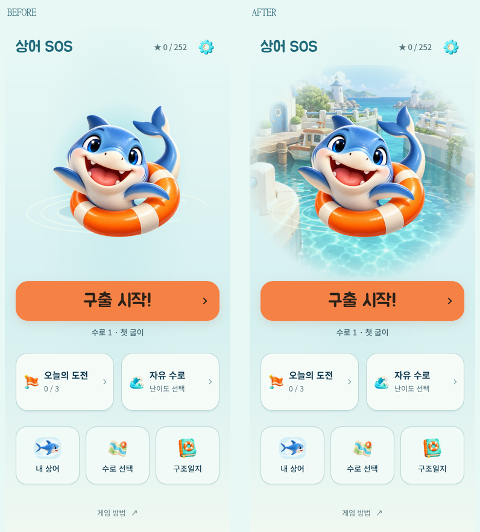
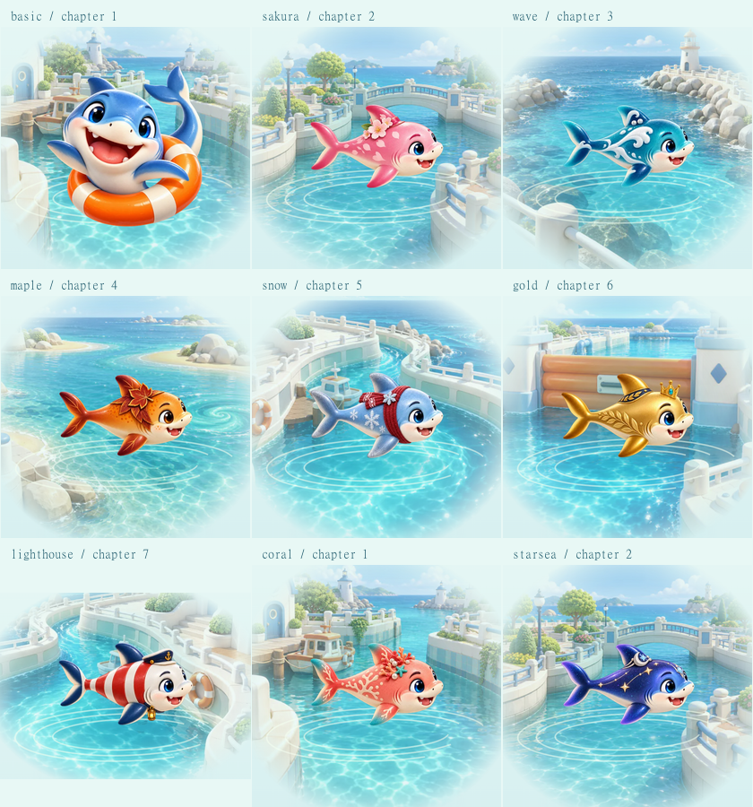

# 상어가 있는 메인 바다 장면

2026-10-15. 변경 전 `e020813`. 메뉴·구출 시작의 위계와 [균형 배치](HOME-BALANCE.md)는 유지하고 상어 주변을 채웠다.

후속 변경: 넓은 페이드·낮은 채도로 흐릿해 보이는 가장자리는 [메인 배경 선명도](HOME-CLEAR.md)에서 좁은 경계 연결과 원래 색으로 다듬었다. 아래는 최초 배경 도입 당시 기록이다.

## 확인과 적용

실제 화면에서 상어 주위에 색 번짐과 물결만 있어 배경 없이 떠 있는 인상이었다. 기존 `drawHero()`도 투명 Canvas 위에 같은 요소만 그리고 있었다.

- 기존 7개 지역 WebP를 재사용해 항구·나무·수평선·수로가 상어 뒤로 이어지도록 했다. 배경은 현재 `구출 시작` / `이어서 구출` 대상 수로의 장에 맞춘다. 수로 선택 시트에서 둘러보는 장과는 분리한다.
- CSS 마스크로 사진 같은 직사각형 경계를 지우고 화면의 옅은 바다색에 연결한다. 채도·불투명도를 낮춰 상어와 주황색 시작 버튼이 선명하게 남는다.
- 상어의 기존 Canvas, 선택 스킨, 물결·터치 반응·동작 줄이기·공용 렌더링 루프는 유지한다. 새 타이머나 반복 애니메이션은 없다. 메인 진입 연출은 배경과 상어를 한 장면으로 묶는다.
- 이미 빌드에 포함되던 지역 자산과 `setRegionArt()`를 재사용한다. 시작 준비 목록에는 추가하지 않으며, 늦거나 실패해도 기존 상어·그라데이션·물결로 즉시 플레이할 수 있다.
- 390×844에서 시작 버튼 위치 **427.875px**, 높이 **66px**와 하단 메뉴 위치가 전후 동일하다. 작은 화면에 맞춰 배경 범위를 조절했다. 기능·문구·보상·진행 형식은 그대로다.

## 검증

- `tools/home-simple-qa.js`: 320×568·360×640·390×844·412×915·844×390, 글자 200%, 동작 줄이기, 모든 메뉴와 시트, 진행 복원, 첫 수로 실제 규칙 자동 풀이→다음 수로, 이미지/글꼴 실패 통과. [보고서](home-scene/report.json).
- `tools/home-scene-qa.js`: 격리한 저장 fixture로 9종 스킨과 7개 지역의 대표 조합을 확인했다. 실제 스킨 선택 버튼→메인 반영→게임 진입, 동작 줄이기에서 정지 상태, 기존 별 기록 유지, 배경만 지연/실패 시 메인 표시 및 시작 가능, 지연 이미지 도착 전후 버튼 위치 동일을 확인했다. [배경 보고서](home-scene/scene-report.json). 전체 지역×스킨 63개 조합이나 실제 사람의 전체 클리어 검증은 아니다.
- `npm test` **267/267**, 정식 수로 **84개**·시험 수로 **12개** verify 통과. standalone/artifact, Android DEV debug APK·서명 release AAB 빌드 성공. 여정 단위 테스트는 기존처럼 장식 렌더링만 제외하고 모든 진행 판정 검사를 유지한다.
- GitHub Pages는 기존 DEV 모드로 배포 후 공개 커밋·파일 해시·새 배경·오프라인 이어하기를 확인한다. 실제 Android 기기 설치·GPU/프레임·실제 터치는 이번 작업에서 미확인이다.

재현: `node tools/serve.js . 5182`. 기본 메인 QA는 `HOME_QA_BASELINE=e020813`, `HOME_QA_NAME=home-scene` 환경 변수로 실행하고, 배경 검사는 `node tools/home-scene-qa.js <playwright 모듈 경로>`를 실행한다. 배경 검사는 저장 상태를 격리하며 출시 빌드에는 들어가지 않는다.
