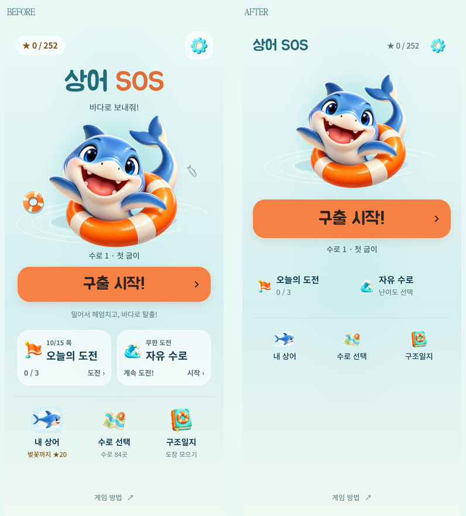

# 메인 화면 간소화

2026-10-15. 변경 전 기준 `874435d`. 기존 결과창의 단순한 정보 위계에 맞춰 메인을 정리했다. 게임 규칙·별·해금·진행 데이터·저장 키와 각 버튼의 이동 경로는 변경하지 않았다.

후속 조정: 하단 여백 분배와 보조 버튼 표시는 [메인 배치 균형과 버튼 구분](HOME-BALANCE.md)을 따른다. 아래 비교는 첫 간소화 당시의 기록이다.

## 확인과 변경

실제 Edge 390×844 화면에서 큰 중앙 로고, 상어 주변 장식, 두 개의 흰색 모드 카드와 메뉴별 보조 문구가 시작 버튼과 함께 강조되는 것을 확인했다. 소스에서는 같은 정보가 모드 이름·태그·설명·시작 문구에 반복되고 있었다.

- 제목·모은 별·설정을 작은 상단 한 줄로 정리했다. 큰 글자에서는 자연스럽게 줄바꿈한다.
- 상어와 바다 분위기는 유지하고, 주변 부표·숭어 장식을 제거했다. 선택한 스킨과 터치 반응·기존 애니메이션은 유지한다.
- `구출 시작!` / `이어서 구출!`만 넓은 주황색 주요 버튼으로 강조했다. 현재 수로와 진행 중 이동 수는 바로 아래에 표시한다.
- 오늘의 도전·자유 수로는 카드 배경과 중복 안내를 덜어낸 두 개의 보조 행동으로 정리했다. 일일 진행 수·완료/이어서 상태·자유 수로 누적 구출 수는 유지한다.
- 내 상어·수로 선택·구조일지는 작은 아이콘과 이름으로 통일했다. 상세 정보는 기존 시트에서 확인하며 화면 읽기용 정보도 유지한다. 게임 방법과 완료 후 엔딩 다시 보기도 유지한다.

390×844에서 시작 버튼의 위쪽 위치는 **418 → 303 CSS px**로 약 **116px** 올라갔고, 높이는 **60 → 66px**가 됐다. 320×568에서도 버튼이 화면 안에 보인다. 세로 공간이 부족하거나 글자가 큰 경우는 본문을 스크롤한다.

## 검증

- `tools/home-simple-qa.js`는 기존 빌드 함수를 사용해 변경 전후를 만들며 저장 키만 격리한다. 정상 해금 상태에서 실제 버튼·키보드·포인터 입력으로 확인했고, 출시 빌드에는 QA 코드가 들어가지 않는다.
- 320×568, 360×640, 390×844, 412×915, 가로 844×390에서 가로 넘침 없음. 주요 터치 영역 44px 이상. 320px + 글자 200%는 브라우저 루트 글자 확대이며 필요한 스크롤과 모든 메뉴 접근을 확인했다.
- 설정·오늘의 도전·자유 수로·내 상어·수로 선택·구조일지·게임 방법 열기/뒤로가기, 수로 목록 스크롤 복원, 설정 시트 포인터 드래그 닫기를 확인했다.
- 빠른 시작 연속 클릭, 실제 한 칸 이동→메인→새로고침→이어하기에서 저장된 판·이동·이력이 동일했다. 첫 수로 실제 규칙 자동 풀이→별 3개 저장→다음 수로 진입도 확인했다.
- 전체 완료 저장 상태를 별도 주입한 검사에서는 `별 더 모으기`와 엔딩 다시 보기를 확인했다. 84개 실제 플레이 완료를 뜻하지 않는다.
- 동작 줄이기, WebP/글꼴 실패 대체 표시, 합성 pagehide/pageshow 후 시작 연출 미반복을 확인했다. [브라우저 보고서](home-simple/report.json).
- `npm test` **267/267**, 정식 수로 **84개**와 시험 코스 **12개** 검증 통과. standalone/artifact, Android DEV debug APK·서명 release AAB 빌드 성공.

GitHub Pages는 기존 개발 빌드로 배포하며 공개 버전·화면·이어하기·오프라인 복원을 별도로 확인한다. 물리 Android 기기의 설치·실제 손가락 터치·OS 글꼴 확대는 이번 작업에서 확인하지 않았다.

재현: `node tools/serve.js . 5182` 실행 후 `node tools/home-simple-qa.js <playwright 모듈 경로>`. 전후 화면은 정상 해금 새 계정 기준이고 공개 Pages는 기존 DEV 표시와 개발 해금을 유지한다.
