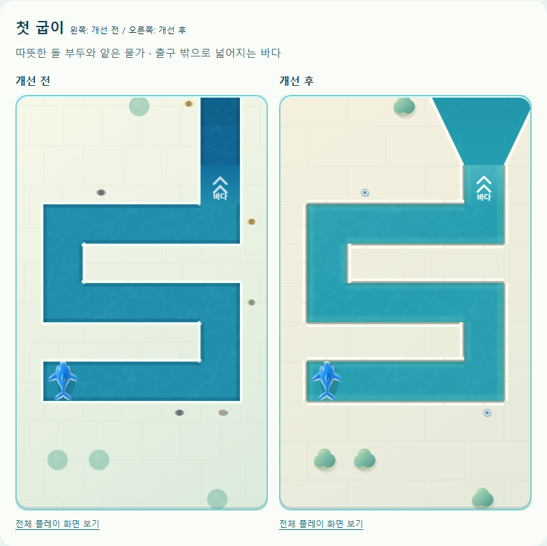
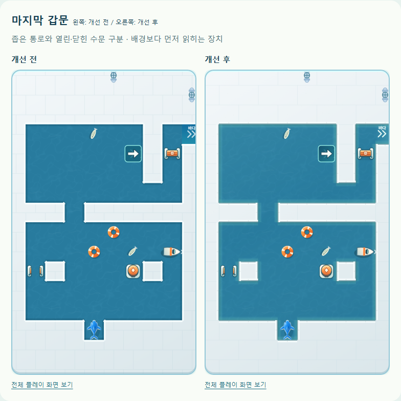

# 맵 그래픽 개선 — 2026-10-14

기준 소스: `310c28d`. **첫 굽이**(저장 인덱스 0)와 **마지막 갑문**(화면 수로 72, 저장 인덱스 59)을 먼저 비교하고 공통 Canvas 렌더러에 적용했다. 규칙·맵 배치·진행 데이터 변경은 없다.

## 확인한 문제와 변경

브라우저 캡처에서 촘촘한 바닥 격자, 가는 흰 경계선, 균일한 수면이 평면적인 미로 도면처럼 보였다. 입체적인 상어와 단순한 원형 수목/작은 구경꾼의 표현 차이가 컸다. 오른쪽 출구는 외곽 열의 화면 크롭 때문에 ‘바다’ 글자가 일부 잘렸다.

- **부두**: 기존 충돌 경계 그대로 돌 윗면·물에 닿는 면·수면 그림자를 구분한다. 돌 표현은 막힌 육지 안에만, 얕은 물색과 그림자는 수면 가장자리에만 그린다. 포장 이음선을 줄이고 작은 재질 입자를 더했다.
- **수면**: 따뜻한 돌과 구분되는 청록색 깊이, 가장자리의 얕은 물색, 약한 반사광을 사용한다. 수문 시설의 기존 차가운 지역 팔레트와 장치 색은 유지한다. 물결 대비를 낮춰 장치와 이동 방향을 먼저 읽게 한다.
- **육지 장식**: 원형 수목을 명암이 있는 낮은 관목으로 바꿨다. 작아서 점처럼 보이던 구경꾼은 드문 계선주로 정리했다. 좁은 섬과 물 칸에는 추가 장식을 두지 않는다.
- **출구**: 기존 출구 타일에서 바깥 바다로 넓어지는 입구를 그린다. 확장은 플레이 가능한 격자 밖으로 클립하므로 이동 판정에는 영향이 없다. 좌우 출구의 글자·화살표를 보이는 영역 안으로 옮겼다.
- **장치**: 수문·스위치의 기존 SVG와 상태 전환을 유지한다. 물줄기 바닥 명암과 그물의 외곽 로프·모서리 부표를 보강했다. 장치 안내 예시에도 같은 물가 표현을 적용했다.
- **화면 크기**: 기존 320px 화면의 조작 글자 겹침과 짧은 가로 화면의 맵 잘림을 발견했다. 좁은 화면은 조작을 세로 배치하고, 짧은 가로 화면은 288px의 맵 높이와 화면 스크롤을 제공한다. Android의 기존 세로 고정은 유지한다.

별도 이미지·프레임워크·애니메이션 루프를 추가하지 않았다. 부두·수목·물가·바다 입구는 기존 `staticLayer`에 수로 진입/화면 크기 변경 때 한 번 그린다. 상어·물결·장치 움직임·동작 줄이기는 기존 프레임 체인을 쓴다. 공통 렌더러이므로 정식 84개, 오늘의 도전, 자유 수로에 같은 표현이 적용된다.

## 전후 비교

같은 390×844 CSS px / DPR 2의 Edge 모바일 에뮬레이션에서 실제 게임 렌더러를 캡처했다. 비교용 빌드는 저장 키를 격리하고 첫 안내를 생략하며 수로 선택 훅은 출시 빌드에 넣지 않는다. 왼쪽이 개선 전, 오른쪽이 개선 후다.





전체 화면, 열린 수문, 그물, 다른 장의 수로, 이미지 실패 대체 표시, 장치 안내는 로컬 `outputs/qa/board-art/review.html`에 함께 보관한다.

## 검증 결과

| 검증 | 결과 |
| --- | --- |
| 기존 자동 테스트 | 237개 통과 |
| 정식 수로 풀이·별 기준·장치 학습 순서 | 84개 통과 |
| 이전 시험 수로 호환 검증 | 12개 통과 |
| 브라우저 실제 렌더링 | 변경 전/후 각각 84개 수로, pageerror 없음 |
| 동일 입력의 상태 비교 | 첫 탈출·그물·수문/구조정/물줄기·상자 수로 4개, 32번 입력 및 클리어 후 상태·저장 세션 완전 일치 |
| 기존 진행 이어하기 | 변경 전 그물이 설치된 세션을 변경 후 새로고침 뒤 복원, 이동·장치·되돌리기 이력 일치 |
| 화면 크기 | 320×568, 360×640, 390×844, 412×915, 844×390; 가로 넘침 없음, 맵 높이 확보 |
| 일반/동작 줄이기 | 일반 이동 정상 종료, 동작 줄이기의 경로·최종 상태 동일 |
| 자산 실패 | 상어 WebP/장치 SVG가 실패해도 기존 Canvas 대체 표시와 새 맵 렌더링 정상 |
| 출시용 PWA | 서비스워커 캐시 후 오프라인 실행·이동·새로고침·이어하기에서 저장 세션 일치, QA 훅 없음 |
| 가로 스크롤 | 실제 브라우저 휠로 하단 조작에 도달하고 처음부터 버튼 동작 확인 |
| 빌드 | standalone, artifact, PWA, Capacitor 동기화, Android debug APK 성공 |

PC에서 마지막 갑문의 `draw()` 50회 호출 중앙값은 전후 모두 약 0.2ms였다. 정적 재질을 매 프레임 다시 만드는 코드는 없으며, 이 수치는 GPU 표시 FPS나 실제 휴대폰 성능의 증거는 아니다.

`src/engine.js`, `src/levels.js`, 생성기, 해금/보상 로직, `STORE_KEY`, 저장 형식·복원 로직은 변경하지 않았다. 배포는 기존 `tools/deploy-pages.ps1`을 사용하고 공개 `version.json` 및 HTML/서비스워커 해시를 대조한다.

## 재현과 확인 경계

```powershell
node tools/serve.js . 5182
node tools/board-art-qa.js <기존-playwright-모듈-경로> 310c28d check
node tools/board-art-report.js <기존-playwright-모듈-경로>
npm test
npm run verify
npm run build
npm run build:artifact
npm run android:debug
```

실제 화면 판단은 PC의 Edge 캡처 기준이다. 이번 변경은 Android APK 빌드까지 확인했으며 실제 Android 기기·Android 에뮬레이터에서의 플레이는 수행하지 않았다. 실물 터치, 저사양 GPU, 발열, OS 글자 크기 확대, iOS Safari와 사람의 플레이 가독성 평가는 별도 확인이 필요하다.
