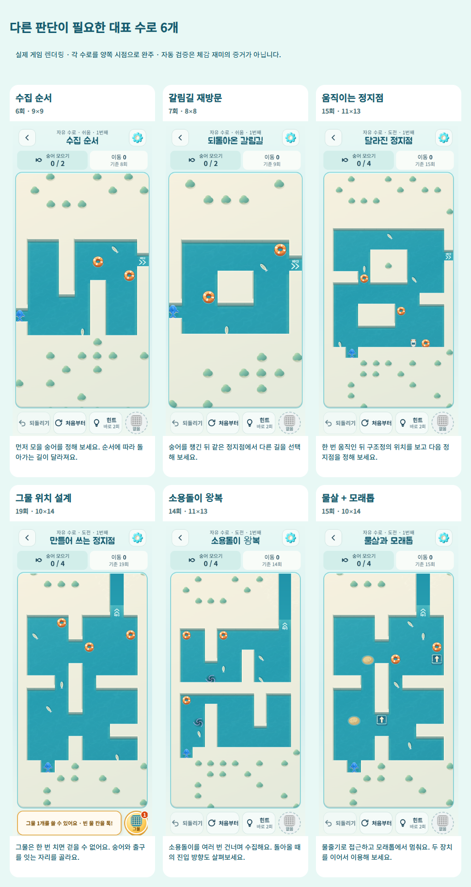

# 풀이 다양화 v6

2026-10-15. 기준 커밋 `76cc298`. 새 자유 수로 전 난이도와 새 일일 작전에 적용한다. 정식 84개, 엔진 규칙, 해금, 스킨, 보상, 별 산정 규칙은 변경하지 않았다.

## 진단

소스에서 확인한 원인: v5는 마스크에 장치를 무작위 배치한 후 최소 이동·탈출 우회·주 장치 사용으로 채택한다. `branches/loop/pockets`라는 이름이 실제 수집 순서나 재방문 방식을 보장하지 않는다. 자유 수로의 기존 중복 회피는 최근 배치 6개와 직전 family/mask를 대상으로 하며, 같은 생각을 다른 배치로 반복하는 것은 걸러내지 못한다. v5 도전 확장은 공간과 이동량을 늘렸지만 이 채택 방식은 유지했다.

실제 표본: 최초 40개씩 생성한 쉬움에서 자유 8/40, 일일 7/40이 단순 좌/우 벽 따라가기 정책으로 전부 수집됐다. 최종 감사는 60개씩으로 넓히고, **자유는 v5의 실제 최근 배치/family/mask 재시도도 재현**했다. 맵 이름이나 방향키 문자열의 다름을 풀이의 차이라고 세지 않았다. 회전/반전과 무관한 수집·재방문·장치 이벤트 순서 및 장치 제거/고정 반례를 사용한다.

## 구현

- `puzzle-catalog-v6.js`: 250개 실제 해법 검증 맵. 쉬움 36개, 보통 108개, 도전 106개. 새로 만든 물살+모래톱 배치와 기존 공간에서 새 기준을 통과한 배치를 포함한다. 이미 좋은 기존 맵은 재사용한다. 회전/반전 복사본을 새 유형으로 추가하지 않았다.
- `puzzle-v6.js`: 배운 장치만 포함하는 난이도별 후보를 선택한다. 진입 시 전체 풀이기를 돌리지 않는다. 자유는 최근 6개 맵과 최근 2개 유형을 제외하고, 최근 행동 순서·직전 벽 구조도 피할 후보를 우선한다. 일일은 날짜에 따라 유형과 맵을 순환하며 한 작전의 세 유형은 겹치지 않는다.
- `tools/puzzle-analysis.js`: 실제 `turn()`으로 해법을 재생한다. 물살/모래톱/소용돌이를 없애거나 구조정을 시작 위치에 고정한 반례를 풀어, 전부 수집 불가 또는 최소 2회 추가가 필요한지 검사한다. 그물은 없어서는 전부 수집할 수 없어야 한다. 탐색 상한 초과(undefined)는 불가능(null)으로 취급하지 않는다.
- 쉬움 4–8회(+2), 보통 6–11회(+1), 도전 14–22회(+0). 일일 앞 두 수로의 기존 5–7회(+2), 8–10회(+1)도 유지한다. 도전은 10×14/11×13, 숭어 4마리이며 탈출만 하는 해법보다 최소 4회 길다.
- 수문·상자는 이번 생성기에 추가하지 않았다. 기존 정식 수로의 장치 학습·동작은 유지한다. 새 복합 유형은 현재 검증 가능한 물살+모래톱에 집중했다.

## 대표 맵과 차이

아래 좌표 방향키는 확인한 최단 해법이며 그물 설치 정보는 audit.json의 steps에 별도로 있다. 단순 방향키만 따라 그물 판을 재생할 수는 없다.

| 유형 / ID | 핵심 판단과 확인한 근거 | 최단 |
|---|---|---:|
| 수집 순서 / 6f6000eb9526 | 위쪽 숭어부터 모으면 9회, 아래쪽부터 모으면 6회. 두 순서 모두 풀 수 있어 선택의 차이가 있다. | 6 |
| 갈림길 재방문 / 187b5d1a1981 | 수집 후 같은 정지점으로 돌아와 다른 경로로 나간다. 첫 숭어 어느 쪽도 7회로 가능하다. | 7 |
| 교차 진입 / 88284f4cb77a | 같은 정지점 반복 없이 지나간 칸을 다른 축으로 재통과한다. 선정 해법의 수직/수평 교차 통과는 5칸. | 11 |
| 이어지는 물살 / 6c7cac83e67f | 서로 다른 물줄기 2개를 이용한다. 물줄기를 제거하면 전부 수집 불가. | 9 |
| 모래톱 새 방향 / 82643f6eca13 | 모래톱 정지 후 직각 방향으로 2번 출발한다. 모래톱 제거 시 전부 수집 불가. | 11 |
| 구조정 정지점 / 56c81ddb5add | 움직인 구조정을 정지점으로 쓴다. 시작 위치에 고정하면 전부 수집 불가. | 15 |
| 그물 위치 / f37b7f1ebc8d | 설치 위치로 새 정지점을 만든다. 그물 없이 전부 수집 불가. v5에서도 유효했던 맵을 유지했다. | 19 |
| 소용돌이 왕복 / dd64b4a6c392 | 한 번 건너고 끝나는 대신 해법 중 3번 건너며 수집한다. 소용돌이 제거 시 전부 수집 불가. | 14 |
| 물살+모래톱 / cf59d74d6530 | 물살 접근과 모래톱 정지를 연결한다. 물살 제거 시 17회, 모래톱 제거 시 전부 수집 불가. | 15 |

[쉬움·보통·도전 전후 실제 화면 비교](puzzle-v6/comparison.png). 이전은 각 난이도의 v5 seed 1, 이후는 위 수집 순서·물살·복합 유형의 예시다. 그래픽 변경 비교가 아니라 서로 다른 배치와 판단의 비교다.

재방문/교차 횟수는 **선정한 한 최단 해법**의 특징이다. 모든 가능한 해법에서 그 행동이 강제됨을 증명한 것은 아니다. 첫 수집 순서 비교와 장치 반례는 별도 탐색으로 검증했다.

## 변경 전후 지표

전 장치를 배운 상태, 버전×모드×난이도별 60개(총 720개). 자유는 실제 화면의 배치 재시도를 모사하며 시드를 순차 공급했다. 일일은 동일 순번을 60날짜 동안 비교한다. 미분류 맵끼리는 같은 유형으로 세지 않는다.

| 지표 | 자유 쉬움 v5→v6 | 자유 보통 v5→v6 | 자유 도전 v5→v6 |
|---|---:|---:|---:|
| 벽 따라가기 정책으로 전부 수집 | 15→0 | 4→0 | 1→0 |
| 최근 6판 내 같은 행동 이벤트 순서 | 30→0 | 3→0 | 0→0 |
| 기준을 충족한 풀이 유형 수 | 3→3 | 6→9 | 5→9 |
| 서로 다른 배치 수 | 60→33 | 60→50 | 60→48 |

일일 쉬움은 벽 따라가기 11→0, 최근 이벤트 반복 36→15. 일일 보통/도전은 유형 6→9로 늘었지만 최근 이벤트 반복은 0→3 / 0→9다. 한 작전 안에서는 세 유형이 항상 다르며, 날짜를 넘긴 같은 순번의 장기 중복까지 제거한 것은 아니다. 원시 해법 문자열이나 중복 없는 배치 수만 보면 기존 생성기가 더 다양할 수 있다.

**한계:** 즉석 무작위 생성에서 검증된 유한한 맵 풀로 바뀌었다. 일일 쉬움의 별 기준을 만족하는 후보는 20개이고, 장기간 플레이하면 맵이 다시 나온다. 최근 판의 해결 방식과 장치 역할을 관리한 개선이며 무한한 새 아이디어를 보장하지 않는다. 행동 이벤트는 방향·거리·물체 위치를 생략한 대리 지표다. 자동 풀이와 반례 검증은 사람의 재미·체감 난이도 증거가 아니다.

## 저장과 실패 처리

v1–v5 생성기는 변경하지 않는다. v5의 720개 출력 지문이 변경 전과 동일하다. 자유 v6는 `puzzleId`와 기존 layout 서명을 함께 보관하며, 학습·최근 이력이 바뀌어도 같은 ID로 복원한다. 최근 유형은 `save.free.thinking`에 난이도별 6개만 저장한다. 기존 저장 키/스토리/스킨 데이터는 유지한다. v4/v5 진행 중 수로의 상태·힌트 복원, 해당 난이도의 새 판만 v6로 교체하는 실제 핸들러 테스트가 통과했다.

이미 시작한 일일 작전은 학습 스냅샷과 이전 버전을 끝까지 유지한다. 준비 취소·실패·동일 맵 반복 시 기존 판/힌트를 보존하는 기존 요청 번호/커밋 순서를 재사용한다. 새 진입은 기존 비동기 yield 경계를 유지한다. 공개된 v6 목록과 선택 로직은 동결 계약이다. 후보 선정 도구는 outputs에만 기록하며 차기 변경은 새 버전을 만들어야 한다.

## 검증과 확인 경로

- `npm test`: 256개 통과. 카탈로그 250개 전부 실제 해법·역할·반례·벽 따라가기 검사, 학습 단계별 720회 자유 선택/이력·복원 및 180날짜 학습 조합×3단계 일일 선택 검사 포함.
- `npm run verify`: 정식 84개와 이전 시험 12개 통과. `engine.js`, `levels.js` 변경 없음.
- `tools/puzzle-v6-qa.js`: 대표 9개×두 시점, 실제 키/그물 포인터 입력·되돌리기·세션 복원·전부 수집 클리어. 320×568, 390×844, 가로 844×390과 로드 후 오프라인 이동 확인, 브라우저 오류 0.
- Node 감사의 v6 선택 시간 95백분위는 모든 모드/난이도에서 0.13ms 이내. 시작 렌더링/이미지/실제 휴대폰 시간은 포함하지 않는다.
- 단일 HTML/artifact, 개발 APK, 출시 AAB 및 출시 자산 검사 통과. 새 문구의 글자를 번들 글꼴에도 포함했다. Android 빌드는 실제 기기 실행의 증거가 아니다.

공개 앱에서 **자유 수로 → 원하는 난이도 → 새 수로**로 확인한다. 기존 이어하기는 원래 판이다. 일일은 아직 시작하지 않은 작전 또는 다음 날짜부터 v6다. 배우지 않은 장치는 나오지 않는다. Pages의 개발 전체 해금과 장치 학습 조건은 별개로 유지한다.

로컬 증거: `outputs/qa/variety-v6/audit.json`, `catalog-evidence.json`, `browser-report.json`, `all-tests.txt`, `before-*.png`, `after-*.png`, `middle-*.png`, `clear-*.png`. 실제 Android 터치/성능, OS 글자 확대와 사람의 재미 평가는 미확인이다.
