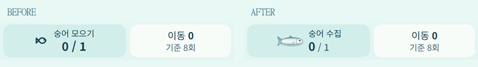
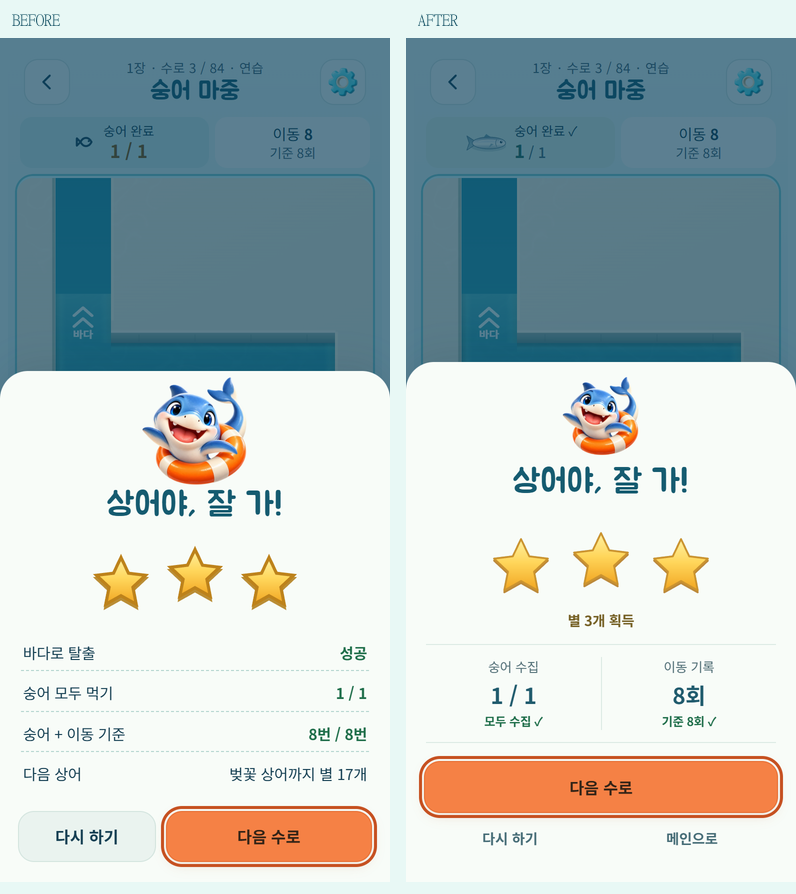

# 숭어 수집 표시와 탈출 결과

2026-10-15. 기준 화면: `cce1847` / Edge 390×844, 동일한 3번 수로와 별 3개 결과. `engine.js`, 수로 정의, 별 판정 함수, 보상·해금·저장 스키마는 변경하지 않았다.

## 확인한 문제

- 실제 화면: HUD는 작은 단색 물고기 기호, 게임판은 은빛 타원 그림이라 같은 수집 대상으로 연결하기 어려웠다. 결과에는 탈출 성공과 조건 행, 다음 스킨 설명이 반복되고 다음 버튼과 다시 하기가 같은 줄에 있었다.
- 소스 확인: 별은 0배 확대·회전으로 등장했고, 효과음이 애니메이션 시작에 호출됐다. 0.9–1.1초 별 잔향이 새 스킨 소리와 겹칠 수 있었다. 저장 선행, 보상 큐, 타이머 취소, 소리/햅틱 설정, 동작 줄이기는 이미 구현돼 재사용했다.

## 변경

- `drawMullet()` 한 그림을 HUD·물속·수집 비행이 공유한다. 은빛 몸통·갈라진 꼬리·눈·지느러미를 Canvas로 그리므로 별도 이미지 요청이 없다. HUD는 44×28 CSS px, DPR 최대 3배로 선명하게 그리고 원래 높이를 유지한다. 숫자와 완료 문구/체크를 함께 제공한다.
- 수집 시 1.05–1.08배의 짧은 반응만 주고 HUD 도착 반응은 기존 효과를 취소해 중첩하지 않는다. 입체 시점의 수집 비행 출발점도 실제 지면 투영과 일치시켰다.
- 성공 제목 → 별/획득 수 → 숭어·이동 두 기록 → 추가 보상 순서. 다음 행동은 전체 너비, 다시 하기·메인은 보조 버튼이다. 일일/자유/시험 코스와 엔딩의 기존 다음 행동을 유지한다. 일일 누적 기록·다음 스킨 목표는 기존 구조일지·내 상어에서 확인한다.
- 별 슬롯 3개를 항상 보여주고 실제 획득분만 겹쳐 안착한다. 시작 300/450/600ms, 안착 접촉 120ms, 모션 길이 300ms로 900ms 이내 완료. 마지막 별은 작은 반짝임만 더한다. 음량을 낮춘 기존 CC0 마림바/글로켄슈필을 재사용하며 잔향은 0.28–0.42초다. 새 음원/라이브러리는 없다.
- 기존 `clearLater`, 보상 토큰, `cancelClearPresentation`, `interruptClearPresentation`, 수명 처리 및 한 개의 렌더 루프를 유지한다. 보상은 결과 등장 전에 저장한다. 동작 줄이기에서는 정적 별과 완료음 한 번을 사용한다. 결과 버튼은 즉시 작동하며 연속 다음 탭은 숨겨진 결과창에서 재실행하지 않는다.
- 작은 화면은 결과 본문을 스크롤하고 다음/보조 버튼을 고정한다. 확대 글자도 본문을 읽고 조작할 수 있다. 마스코트 로딩 실패는 이미지 숨김, 숭어는 Canvas와 텍스트, 오디오 실패는 기존 무음 경로로 계속 작동한다.

## 전후와 영상

[소리 포함 약 7초 영상](result-polish/escape-with-audio.webm) · [영상 재생 페이지](result-polish/video.html)

영상은 정식 **7번 수로**(`LEVELS[3]`)를 실제 엔진으로 자동 조작해 수집·탈출한 브라우저 화면이다. CDP 화면 프레임과 게임의 컴프레서 뒤 Web Audio 출력을 같은 MediaRecorder로 기록했다. 대체 사운드를 덧붙이지 않았다. 오디오 트랙 1개, 실제 음성 데이터 존재 및 클리핑 없음까지 확인했다. 물리 스피커/햅틱 체감이나 사람의 직접 플레이 영상은 아니다.

## 검증

- `npm test`: **266/266**. 실제 저장/보상 함수, 모드 복원, 별 판정, 공개된 이전 맵 호환, 취소/숨김/음소거 등을 포함한다. 추가 검사는 짧은 별 사운드의 종료·취소와 입체 수집 비행 좌표에 집중했다.
- `npm run verify`: 정식 84개 + 동결된 시험 코스 12개 통과.
- standalone/artifact 및 출시 웹 빌드/출시 자산 검사 통과. Android DEV debug APK, 서명된 release AAB 생성 성공. 출시 빌드에는 개발 해금/QA 훅이 없다.
- Edge 모바일 에뮬레이션: 0/일부/전체 수집, 한 이동의 다중 수집, 실제 정식 수로 해결, 별 1/2/3, 모드별 다음 행동, 자유 재도전 보상 중복 없음, 작전 완료 도장, 장 완료·스킨 해금.
- 연출 중 다음/다시/메인 3연속 호출, Escape, 앱 중단 모의/복귀, 실행 중 동작 줄이기 변경: 늦은 별/해금 소리 없음, 예약 큐 정리, 저장된 보상 유지.
- 소리·햅틱 설정, 오디오 생성 실패, 마스코트 실패, 320×568/390×844/844×390, DPR 2/3, 계산 글자 크기 200% 검사. 다음/다시/메인은 최소 44px, 화면 안 유지. 본문을 스크롤해 추가 보상에 접근. 브라우저 JS 오류 0.
- 원본 보고서: [브라우저](result-polish/after-report.json), [녹화](result-polish/video-report.json), [오디오](result-polish/audio-report.json). 빌드·테스트 로그와 개별 캡처는 `outputs/qa/result-polish/`에 있다.

GitHub Pages는 기존 개발 빌드 정책으로 배포하고 공개 `version.json`과 실제 게임 화면/결과, 오프라인 재실행을 배포 후 확인한다. 물리 Android 기기의 설치·스피커·네이티브 햅틱 및 OS 백그라운드 전환은 확인하지 않았다.
