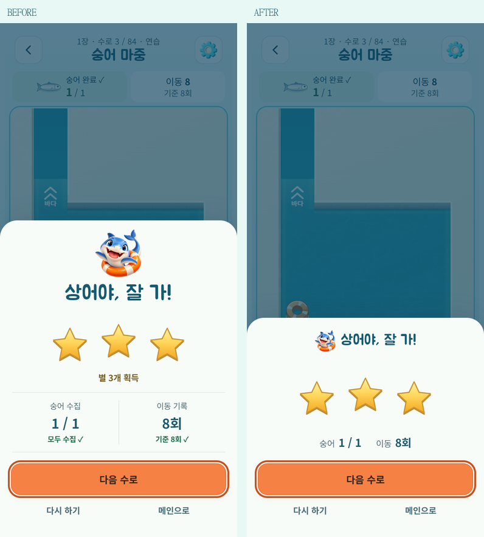
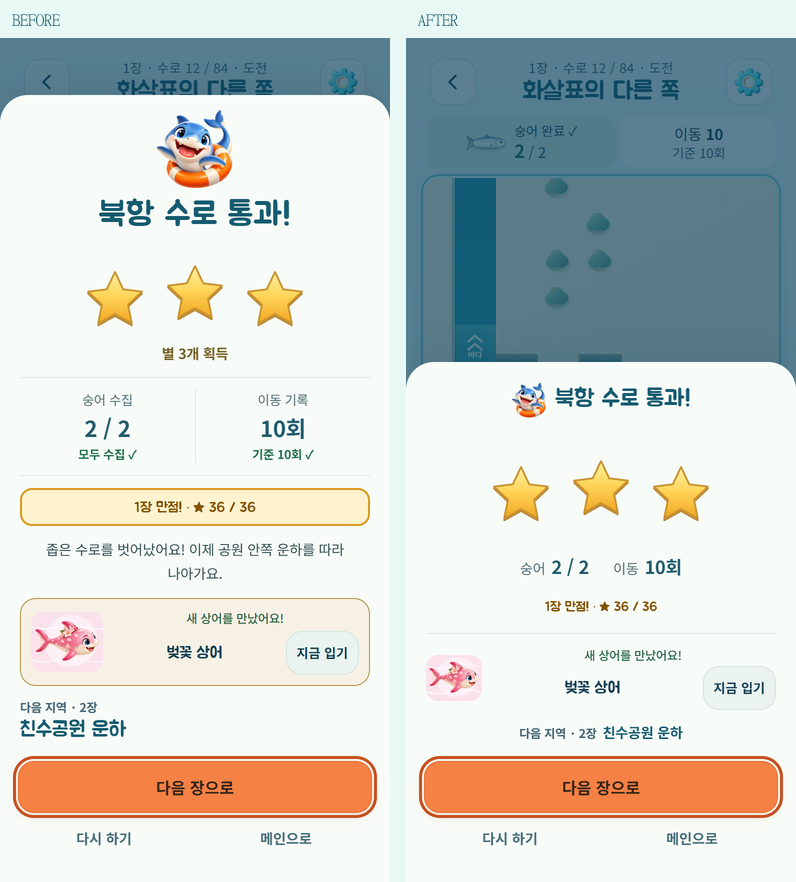

# 탈출 결과창 간소화

2026-10-15. 기준 `2d99c71`, Edge 390×844 / DPR 2. 같은 정식 3번 수로 결과와 1장 완료·스킨 해금 조건을 비교했다. 화면 비교는 격리된 결과 상태를 사용하며, 실제 규칙 자동 조작은 별도 7번 수로 영상과 기존 결과 QA로 확인했다.

## 확인과 변경

실제 화면에서는 큰 상어 그림, 큰 제목, 별 개수 문구, 3줄짜리 기록이 각각 세로 공간을 사용했다. 장 완료 시에는 테두리 배지, 이야기, 새 상어 카드, 다음 지역 설명이 이어졌다. 소스에서는 제목의 `flex-shrink: 0`이 작은 화면·큰 글자에서 새 가로 배치의 줄바꿈을 막는 것도 확인해 결과 제목에만 해제했다.

- 선택한 상어를 36px로 제목 옆에 배치하고, 별을 결과의 중심으로 유지했다.
- 중복되는 별 개수 문구는 화면 읽기용으로 유지한다. 숭어 수집 수와 이동 횟수는 한 줄에 배치하고, 좁은 화면/큰 글자에서는 자연스럽게 줄바꿈한다.
- 별 1·2개 결과의 획득 조건 안내, 일일/자유/시험 코스 기록과 다음 행동은 유지한다.
- 장 완료·새 도장·새 스킨을 간결한 행으로 표시한다. 스킨 그림과 즉시 착용 기능, 다음 지역 이름을 유지했다. 긴 장 이야기는 결과창에서 제거했으며 기존 수로 선택의 장 설명·다음 장 소개는 그대로다.
- 버튼은 다음 행동을 가장 크게, 다시 하기·메인은 보조로 유지한다. 작은 화면에서는 결과 본문만 스크롤되며 주요 버튼은 고정된다.
- 별 판정·모션·타격음·햅틱·보상·저장·해금·모드 진행은 변경하지 않았다.

일반 결과창 높이는 **520 → 360 CSS px**, 장 완료와 새 스킨이 함께 있는 결과는 **787 → 520 CSS px**다. 일반 모바일 화면에서는 두 경우 모두 본문 스크롤 없이 버튼까지 보인다.

## 검증

- `npm test` **267/267**, 정식 84개와 시험 코스 12개 verify 통과. 제거한 이야기 문구에 대한 과거 화면 단언만 정리하고 다음 장·보상·기록 검사는 유지했다.
- `tools/result-polish-qa.js`: 별 1/2/3, 실제 정식 수로 해결, 일일·자유 수로, 장 완료/해금, 빠른 다음/다시/메인, Escape, 중단/복귀, 음소거/햅틱, 동작 줄이기, 이미지/오디오 실패 검사. 이벤트 취소 검사는 사용자 동작과 같은 JS 실행 안에서 관측해 첫 효과음과 도구 호출 사이의 경합을 피한다.
- `tools/result-simple-qa.js`: 동일 조건 전후 높이, 화면 읽기용 별 수, 새 스킨 착용/저장, 320×568·390×844·844×390의 글자 200% 상태에서 가로 넘침 없음, 모든 버튼 최소 44px와 화면 내 위치를 확인했다. [보고서](result-simple/report.json).
- standalone/artifact, 출시 웹 검사, Android DEV debug APK와 서명 release AAB 빌드 성공.
- [새 결과창 영상](result-polish/video.html)은 정식 7번 수로의 실제 엔진 자동 조작이다. 브라우저 게임 소리 포함. 기존 별 연출·타격음을 유지한다.

GitHub Pages는 기존 개발 빌드로 배포 후 공개 버전·화면·오프라인 복원을 확인한다. 물리 Android 기기 설치·터치·스피커 청취는 이번에도 미확인이다. 브라우저 검증은 실제 기기 검증을 대신하지 않는다.
