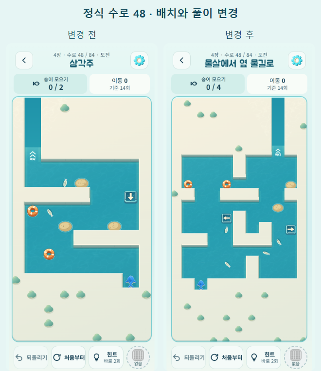
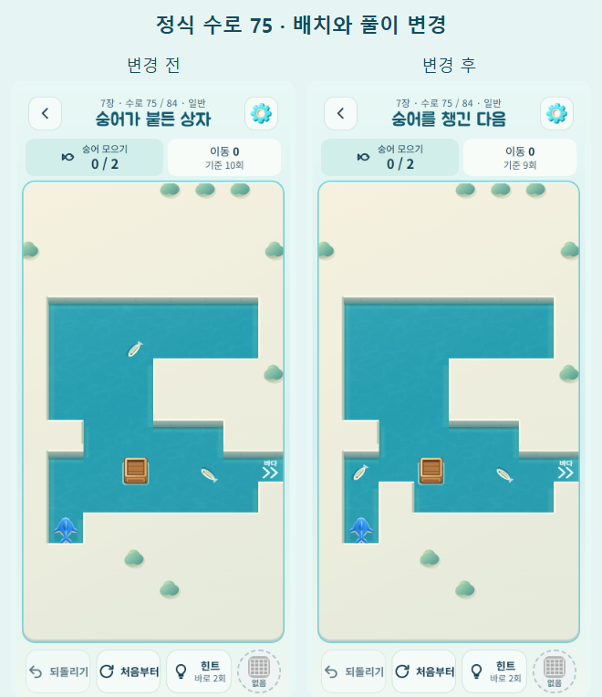

# 정식 수로 다양화와 자유 수로 전체 장치 — 2026-10-15

## 적용 범위

- **정식 수로 4–84번, 총 81판을 변경했다.** 1–3번의 기본 이동 안내는 그대로다. 저장 인덱스·플레이 순서·장 수·해금·보상은 유지한다.
- 자유 수로는 v7부터 모든 난이도에서 부표, 물줄기, 구조정, 그물, 모래톱, 소용돌이, 수문/스위치, 상자를 제공한다. 정식 수로 학습 여부로 제외하지 않는다. 한 판에 모두 넣지는 않는다.
- 기존 자유 v6의 250개에 새 88개를 더한 **338개 풀**이다. 쉬움 10유형, 보통/도전 11유형을 가장 오래 나오지 않은 순으로 선택한다. 최근 12개 판과 겹치지 않게 하고, 가능한 경우 행동 순서와 직전 벽 형태도 다르게 고른다.
- **오늘의 도전은 변경하지 않았다.** 기존 날짜별 생성, v1–v6 자유 판과 이전 정식 진행은 보존한다.

## 무엇이 달라졌는가

이전 v6 작업은 새 자유/일일 판을 대상으로 했고 정식 수로는 그대로였다. 자유 수로에는 수문/상자 유형이 빠져 있었으며, 배운 장치만 고르는 제한 때문에 초반에는 기본 유형에 편중됐다.

정식 수로는 방향 문자열만 바꾸거나 좌우 반전하는 대신 숭어 수집 순서, 다시 돌아오는 갈림길, 가로세로 교차, 물줄기 연결, 모래톱에서 방향 전환, 움직이는 구조정으로 멈추기, 그물 위치, 소용돌이 왕복을 장마다 섞었다. 후반에는 수문과 그물/물살/구조정, 상자와 먹이/모래톱/구조정/수문을 조합한다.

선택한 최단 해법의 숭어 수집·장치 사용·회귀 사건 순서는 변경한 81판 모두 이전과 다르다. 회전/반전을 같은 것으로 취급한 벽 형태도 67종에서 84종으로 늘었다. 단순 벽 따라가기 8개 정책 중 하나로 풀리는 판은 11개에서 7개로 줄었다. 남은 것은 기본 안내/연습 판이다. **이 지표는 사람의 재미나 체감 난이도 평가가 아니다.**

| 수로 | 바뀐 핵심 | 전부 수집 최소 이동 / 별 3개 기준, 이전 → 현재 |
|---|---|---|
| 8 | 두 물살을 이어 타며 수집/회귀 | 8/9 → 7/8 |
| 25 | 첫 그물 정지점과 수집 경로 | 5/7 → 5/7 |
| 48 | 넓은 판에서 물살과 모래톱을 연결 | 14/14 → 14/14 |
| 63 | 수문을 두 번 바꾸는 경로 | 8/10 → 6/8 |
| 75 | 먼저 먹은 숭어 자리로 상자를 밀기 | 9/10 → 8/9 |
| 76 | 옮겨 놓은 상자를 다음 정지점으로 사용 | 10/11 → 10/11 |
| 79 | 구조정이 상자를 멈추는 위치 이용 | 실제 해법에서 확인 |
| 80 | 모래톱에 상자 내려놓기 | 실제 해법에서 확인 |
| 84 | 구조정·상자 2개를 쓰는 마무리 | 18/18 → 18/18 |

## 진행 호환과 규칙

엔진의 이동·그물·장치 규칙은 수정하지 않았다. 역할별 별 기준은 실제 최단 이동에 연습 +2, 일반 +1, 도전 +0을 적용했다. 기존 최고 별을 다시 계산하거나 낮추지 않는다. 초반 6판과 상자 학습 판은 도달 가능한 상태에서 탈출 불가능한 상태가 없는지 검사한다.

`STORY_PRE_VARIETY_LEVELS`는 업데이트 직전 84개 정의 전체를 동결한다. 더 오래된 16개 정의는 `LEGACY_STORY_LEVELS`로 계속 유지한다. 저장된 맵 서명이 일치하면 기존 판으로 이어하고, 그 판의 ‘처음부터’도 기존 정의를 사용한다. 목록에서 새로 진입할 때 새 배치가 적용된다. 과거 파일럿 진행의 이관은 동결된 `PILOT_LEVELS`로 검증한다.

자유 수로는 저장된 버전/퍼즐 ID로 복원하고 **새 수로** 요청부터 v7을 사용한다. 수문 상태, 상자 위치, 숭어, 그물, 구조정, 되돌리기, 힌트 사용 기록을 유지한다. 개발 빌드 전체 해금은 계속 별도 저장소에 적용하며 출시용 빌드에는 들어가지 않는다.

## 검증

- `npm test`: **263/263 통과**. 신규 검사: 81판의 실제 행동 순서/풀이 패턴, 88개 장치 판의 의미 있는 사용, 난이도별 132회 선택과 전체 장치 출현, 이전 84판의 실제 중간 상태 복원/재시작, 이전 자유 v6 복원. 기존 날짜별/자유 v1–v6 지문 회귀도 통과했다.
- `npm run verify`: 정식 84판과 동결 파일럿 12판의 해법·역할별 별 기준·장치 도입 순서 통과.
- Edge 모바일 에뮬레이션: 정식 84판을 실제 방향키/그물 좌표 입력으로 전부 수집 클리어. 수문/상자 조합 등 10판은 탑뷰에서도 클리어하고 되돌리기/진행 복원을 확인했다.
- 진행 기록 0인 상태에서 실제 자유 수로 메뉴로 11개 유형을 연속 선택(중간 새로고침 포함), 수문·상자·그물·소용돌이 첫 만남 안내와 클리어 확인.
- 320×568 / 390×844 / 844×390 화면에서 84번 판 확인. 로드된 판의 오프라인 이동 확인. JavaScript 오류 0건.
- Android 디버그 APK 및 출시용 AAB 빌드 성공. 출시 자산 검사 통과. **실제 Android 기기 설치/터치와 사람의 난이도·재미 평가는 미실시**다.

재현: `tools/content-v7-qa.js <Playwright 모듈 경로>`는 로컬 서버(저장소 루트, 5182번 포트)와 격리된 저장소를 사용한다. 실제 게임의 입력/렌더러를 쓰며 QA 훅은 배포에 들어가지 않는다. `outputs/qa/story-v7/`에 전후 캡처, `audit.json`, `browser-report.json`, 테스트·빌드 로그를 보관한다. 개발 전용 비교 페이지와 다른 별도 로컬 검증이다.

## 남은 한계

자유 수로 후보는 유한하므로 장시간 플레이하면 예전 판이 다시 나올 수 있다. 단순 방향/외형 중복과 반복 유형을 줄이는 장치이지 무한한 새 콘텐츠는 아니다. 풀이 패턴은 선택한 최단 해법과 장치 제거/고정 비교로 검증했으며 모든 동률 해법이 같은 행동을 강제한다고 보장하지는 않는다. 실물 기기에서 작은 장치가 많은 판의 읽기 쉬움과 사람의 난이도 곡선은 별도 확인이 필요하다.
