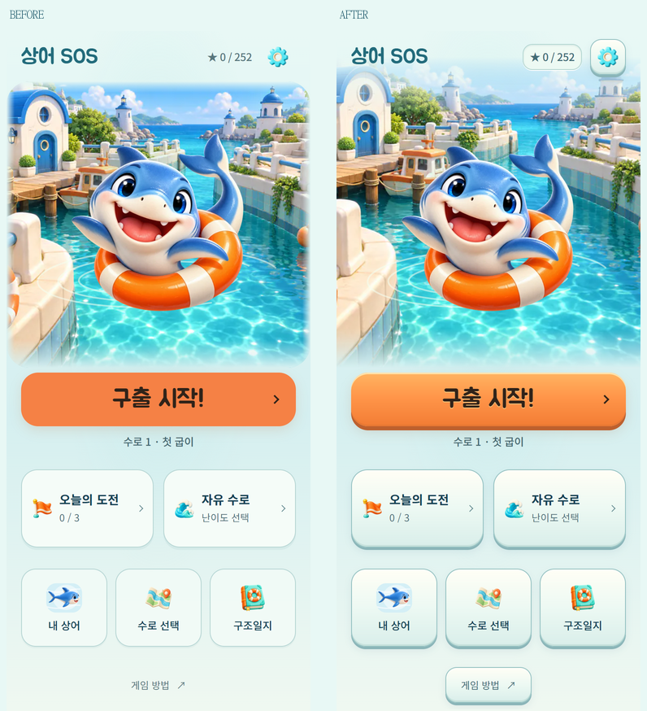
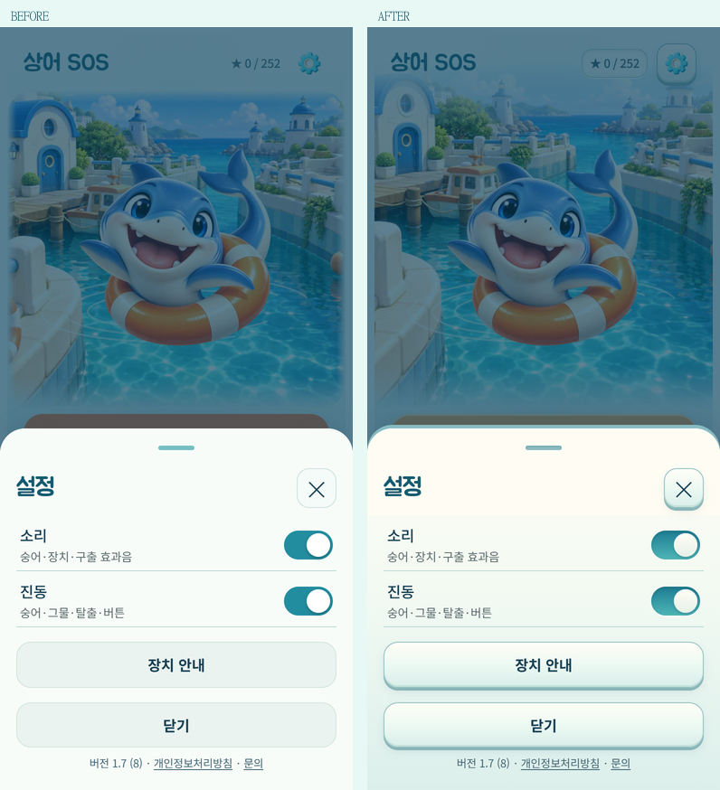
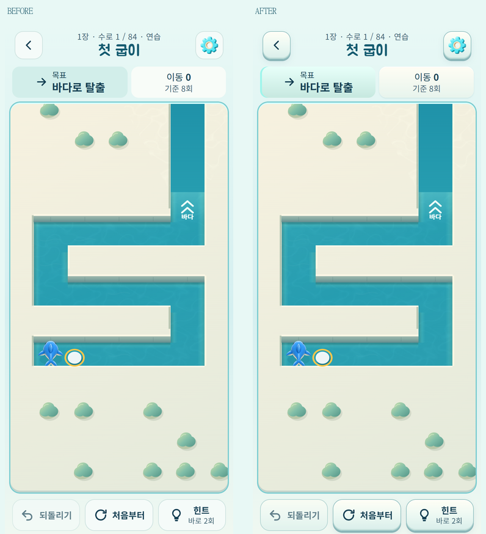
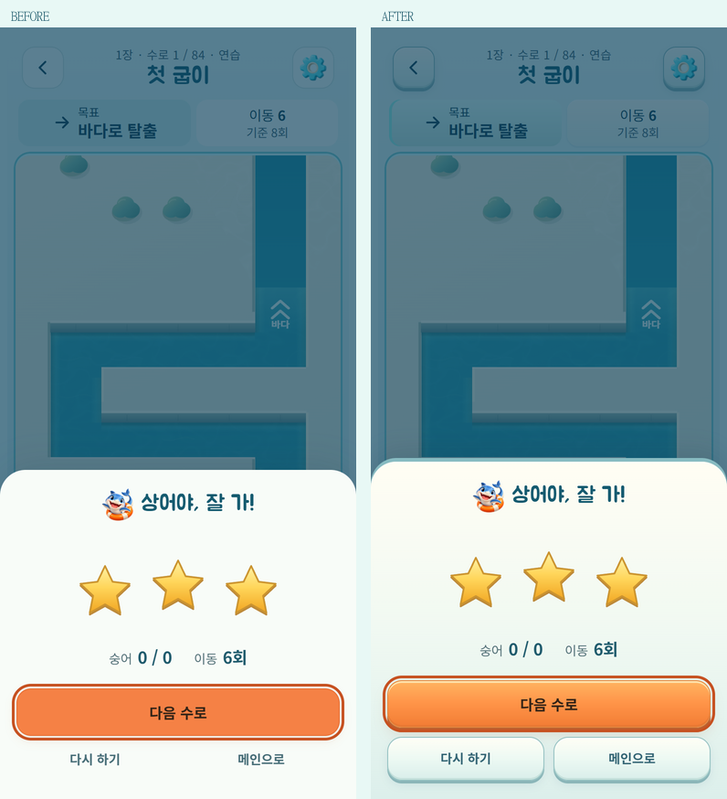

# 바다 장면과 UI 재질 통일

2026-10-15. 기준 `7a2a9ab`. 단순한 정보 구조는 유지하면서 클릭 영역과 입체감을 복원했다. 이 문서의 버튼·배경 표현이 HOME-CLEAR/RESULT-SIMPLE 등 이전 시각 기록보다 최신이다.

## 현재 화면에서 확인한 원인

- 배경의 직선 마스크와 28px 모서리가 선명한 사각 이미지 테두리처럼 보였다.
- 메인 모드/메뉴에는 옅은 버튼 면이 있었지만 게임 방법, 결과의 다시 하기/메인, 장치 안내의 예시/자세히 보기는 면과 테두리가 없어 텍스트처럼 보였다.
- 공통 버튼의 `box-shadow: none` 및 단색 배경이 상어·장치의 입체 그래픽과 다른 재질로 보이게 했다. 이는 실제 화면과 CSS를 함께 확인한 결과다.

## 적용 기준

- **배경**: 좌우 마스크와 둥근 프레임을 제거하고 상단 하늘을 헤더 쪽으로 확장했다. 화면 양끝으로 이어지는 구도로 바꾸고 하늘·아래 물결만 화면색에 연결한다. 중앙 그림의 원래 색과 불투명도 1은 유지한다. 기존 7개 지역 자산을 쓰며 이미지 크기/로드 경로는 변경하지 않았다.
- **버튼**: 공통 CSS 변수로 밝은 윗면, 청록색 아래쪽 두께, 접촉 그림자를 정의한다. 메인 메뉴·설정·수로 선택·스킨·일일/자유·장치 안내·인게임 조작·결과 행동에 공유한다. 버튼을 누를 때 두께가 줄어들고 2–3px 내려온다. 기존 입력/포커스/시트 드래그/동작 줄이기는 재사용한다.
- **우선순위**: 구출 시작과 다음 행동은 주황색의 가장 큰 버튼, 보조 행동은 아이보리·청록 재질로 구분한다. 390×844에서 메인 시작 버튼의 상단 427.875px·높이 66px와 보조 메뉴 위치는 전후 동일하다.
- **패널·상태**: 시트에도 같은 빛 방향과 얕은 외곽 두께를 적용한다. 선택 상태는 청록색, 잠금 상태는 낮은 대비와 잠금 문구로 구분한다. 자유 수로의 설명 칸·보상 기록 등 비클릭 정보는 낮은 패널로 두고 버튼과 구별한다.
- 게임 규칙·보상·해금·진행·저장·모션 타임라인·사운드 코드는 변경하지 않았다. 제품 변경은 `src/art-theme.css`에 한정한다. 단순화할 때 버튼의 면까지 없애지 않는 것이 이후 기준이다.

다른 화면 비교: [장치 안내](ui-depth/guide-comparison.png), [수로 선택](ui-depth/map-comparison.png), [내 상어](ui-depth/skins-comparison.png), [자유](ui-depth/free-comparison.png), [일일](ui-depth/daily-comparison.png), [구조일지](ui-depth/journal-comparison.png).

## 검증과 범위

- `npm test` **267/267**, 정식 **84개**·시험 **12개** 수로 verify 통과.
- 메인 QA: 320×568·360×640·390×844·412×915·844×390, 글자 200%, 동작 줄이기, 모든 메뉴, 실제 시트 드래그, 연속 시작/뒤로가기, 실제 이동 후 재실행·이어하기, 첫 수로 풀이·다음 수로, 이미지/폰트 실패 통과. [보고서](ui-depth/report.json)
- `tools/ui-depth-qa.js`: 실제 포인터 누름의 그림자 변화, 각 화면의 버튼 영역·최소 44px 높이, 장치 선택·설명 펼치기, 실제 규칙의 첫 수로 풀이와 별 저장, 작은/가로 화면의 결과 버튼 노출을 확인한다. [보고서](ui-depth/surfaces-report.json)
- 배경 QA: 9스킨·7지역 대표 조합, 동작 줄이기, 배경만 늦거나 실패해도 시작 가능, 이미지 도착 시 버튼 이동 없음. 전체 63개 조합 전수 검증은 아니다. [보고서](ui-depth/scene-report.json)
- 기존 결과 QA: 별 1/2/3, 정식/일일/자유, 장 완료/스킨 보상, 빠른 이동·취소, 음소거·햅틱·동작 줄이기·오디오 실패·글자 확대 통과. [보고서](ui-depth/result-report.json)
- standalone/artifact, Android DEV debug APK와 release AAB 빌드 성공. 물리 Android 기기·OS 글자 확대·GPU/프레임은 미확인이다. 브라우저 글자 확대와 백그라운드 이벤트는 모의 검증이다.
- GitHub Pages는 기존 DEV 모드로 배포한다. 배포 후 공개 `version.json.sourceCommit`/파일 해시, 실제 화면과 오프라인 이어하기를 `outputs/qa/ui-depth/verify-public.cjs`로 검증하고 같은 폴더에 결과를 보관한다.

재현: `node tools/serve.js . 5182`. `HOME_QA_BASELINE=7a2a9ab`, `HOME_QA_NAME=ui-depth` 설정 후 `tools/home-simple-qa.js`, `tools/home-scene-qa.js`, `tools/ui-depth-qa.js`에 Playwright 모듈 경로를 전달한다. QA 저장은 별도 키로 격리하며 출시 빌드에는 포함되지 않는다.
