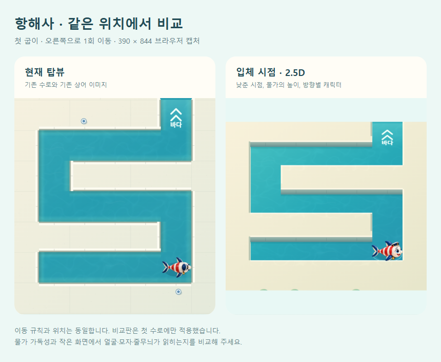
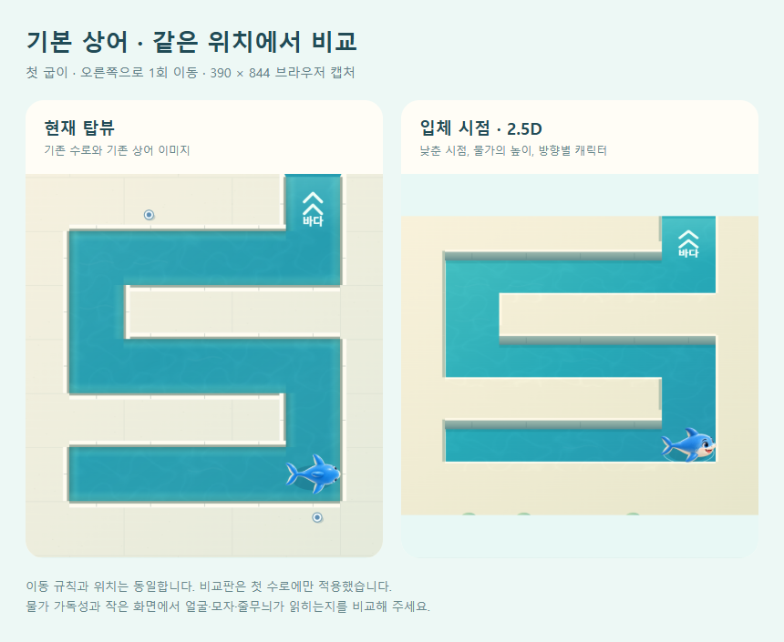

# 탑뷰 / 입체 시점 비교판

2026-10-14. 공개 주소: https://kongrae.github.io/bukang-sea/compare/

첫 수로 **첫 굽이**에서 현재 탑뷰와 약한 사선의 2.5D 시점을 직접 전환한다. 기본 상어와 항해사(기존 `lighthouse`) 스킨을 선택하고 스와이프·방향 버튼·방향키로 실제 퍼즐을 플레이한다. 오른쪽으로 한 번 이동한 뒤 시점을 바꾸면 같은 위치에서 얼굴과 모자를 비교하기 쉽다. 상단 뒤로가기는 정식 게임으로 돌아간다.

## 달라진 부분과 범위

이전 맵 개선은 동일한 탑뷰 안에서 수면·물가·재질을 정리했다. 상어는 기존 위에서 본 이미지 한 장을 회전했기 때문에, 스킨 미리보기의 얼굴·모자·몸통 부피가 인게임에서 거의 드러나지 않는 구조는 남았다.

이번 비교판은 화면의 상하좌우를 유지하면서 수로의 세로 투영을 0.78로 낮추고 물가 상판과 수직 벽을 분리했다. 벽의 아래쪽은 기존 충돌 경계에 둔다. 상어는 기본/항해사 각각 네 방향 이미지를 따로 사용하며 그림의 조명이나 얼굴을 회전하지 않는다. 얼굴과 몸체는 이미 투영된 비트맵이므로 게임판의 세로 압축을 중복 적용하지 않는다. 좌우로는 얼굴과 옆모습, 아래 방향은 정면, 위 방향은 뒷모습이다.

정식 게임의 전체 맵·스킨 교체는 하지 않았다. **첫 수로와 두 스킨의 비교 적용**이다. 정식 `game.js`, 이동 규칙, 스테이지, 보상, 해금, 저장·복원은 수정하지 않았다. 빌더에서 기존 게임의 렌더 함수만 비교용으로 교체하며 기존 입력·이동 보간·프레임·동작 줄이기를 재사용한다. 비교판의 저장 키는 `bukang-view-comparison-v1`로 분리했다. 다시 열 때는 첫 수로부터 시작하며 정식 게임 진행에 합쳐지지 않는다.

`build:web`은 별도 `compare/index.html` 및 자체 서비스워커를 생성한다. 새 그림은 정식 메인의 로딩 목록에 추가되지 않는다. 비교판은 첫 로드와 캐시 설치 이후 오프라인 재접속이 가능하다. 기존 메인 서비스워커가 모든 탐색 응답을 메인의 `index.html`로 저장하던 부분도 고쳤다. 이전 워커를 이미 설치한 브라우저에서는 비교판이 부모 워커 업데이트를 요청해 잘못 저장될 수 있는 메인 캐시를 새 빌드로 복구한다. 비교판과 메인은 서로 다른 캐시 이름을 사용한다.

## 실제 화면 비교

같은 브라우저, 390×844 CSS px, DPR 2, 첫 수로 오른쪽 1회 이동. 합성 그림이 아니라 실제 Canvas 화면을 캡처해 HTML에 나란히 배치했다.





원본 캡처: `outputs/qa/view-lab/`. 재생성 가능한 비교 문서: `docs/view-lab/basic.html`, `lighthouse.html`. 생성 모드·참조·원본·최종 프롬프트는 `assets/art/oblique-v1/README.md`에 있다.

## 검증

| 항목 | 결과 |
| --- | --- |
| 기존 자동 테스트 | 237/237 통과 |
| 기존 정식/시험 수로 검증 | 84개 + 12개 통과 |
| standalone / artifact / PWA 빌드 | 통과, 메인 standalone/artifact 내용 변경 없음 |
| 비교 화면 | 두 시점 × 두 스킨, 동일 위치·이동·이력 유지 |
| 실제 게임 규칙 | 첫 수로 R U L U R U, 6회 이동 탈출; 되돌리기·다시 시작 통과 |
| 방향별 그림 | 실제 R U D 입력으로 정면 확인; 초기 U, 경로의 L/R도 확인 |
| 전환 중 입력 | 이동 중 시점 변경, 20회 빠른 입력, 이동 중 초기화 후 중복 실행·입력 잠금 없음 |
| 저장 보존 | 비교 전후 정식 저장 문자열 바이트 일치 |
| 화면/접근성 | 320×568, 390×844, 430×932 가로 넘침 없음; 주요 버튼 ≥44 CSS px; 작은 화면 본문 스크롤로 하단 조작 도달 |
| 글자/동작 | 비교 UI 글자 200% CSS 확대에서 세로 스크롤·조작 가능; 동작 줄이기 이동 통과 |
| 이미지 실패 | 모든 이미지 디코딩 실패 주입 시 기존 Canvas 대체 그림으로 실행·이동 가능 |
| 오프라인 | 캐시 설치 후 비교판 새로고침·이동 통과; 메인 캐시가 비교판으로 바뀌지 않음 |
| 이전 서비스워커 | 이전의 탐색 캐시 동작 재현 → 비교판에서 신규 워커 갱신 → 오프라인 메인이 정식 게임임을 확인 |
| 백그라운드 유사 중단 | 브라우저 pagehide/pageshow 이벤트 주입 후 커밋된 이동 보존 |
| 브라우저 오류 | 위 검사에서 pageerror 0 |

브라우저 기록: `docs/view-lab/browser-checks.json`. 기존 워커 갱신은 `tools/view-lab-sw-qa.js`로 별도 검증한다.

## 확인 경계와 남은 판단

- PC Edge 브라우저 검증이다. 실제 Android 기기의 터치·복귀·발열·프레임, OS 글자 확대와 iOS Safari는 확인하지 않았다. 이번 비교판을 기본 화면으로 쓰는 새 APK를 배포하지 않았다.
- 첫 수로는 장치가 없어서 부표·수문·구조정이 많은 맵의 가림과 전후 관계는 이 비교판에서 검증하지 않았다. 전체 적용 여부를 판단한 뒤 그 렌더 순서와 오브젝트 높이를 별도로 검증해야 한다.
- 북쪽 이동은 뒷모습이므로 언제나 얼굴을 보여 주는 방식은 아니다. 방향별 형태 전환은 현재 즉시 바뀌며, 새 이미지에는 기존 꼬리 부분 굽힘이 적용되지 않는다.
- 모자·얼굴은 좌우에서 더 잘 드러나지만 작은 수로의 세부 랜턴·장식까지 선명해지는 것은 아니다. 사람의 가독성·미적 선호는 자동 테스트로 입증하지 않았다.

## 재현

```powershell
npm run build:web
node tools/serve.js . 5182
node tools/view-lab-qa.js <기존-playwright-모듈-경로>
node tools/view-lab-sw-qa.js <기존-playwright-모듈-경로>
node tools/view-lab-report.js <기존-playwright-모듈-경로>
npm test
npm run verify
npm run build
npm run build:artifact
```

로컬 주소는 `http://localhost:5182/www/compare/`. 공개 배포는 기존 `tools/deploy-pages.ps1`을 사용하며 배포 후 `version.json`의 sourceCommit, 공개 비교 HTML/워커와 로컬 생성물의 해시를 대조한다.
