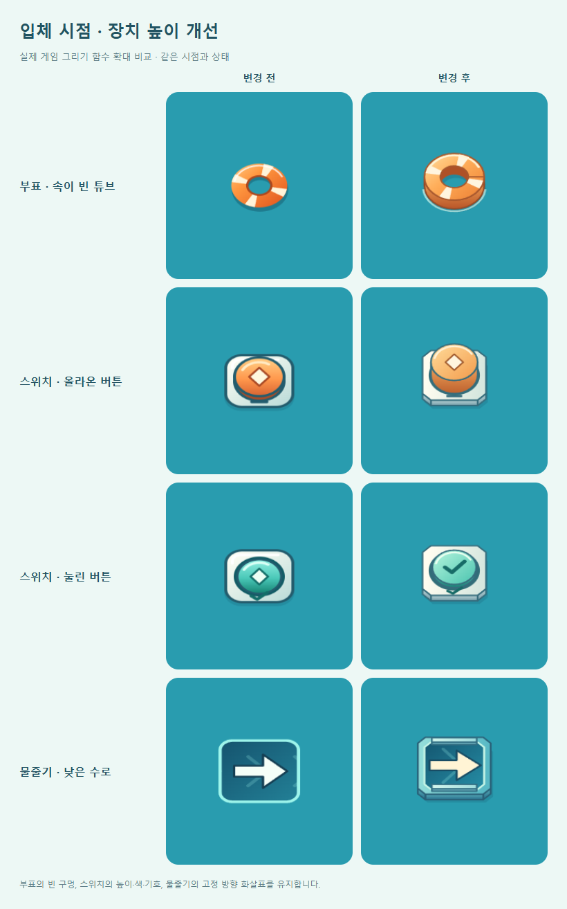
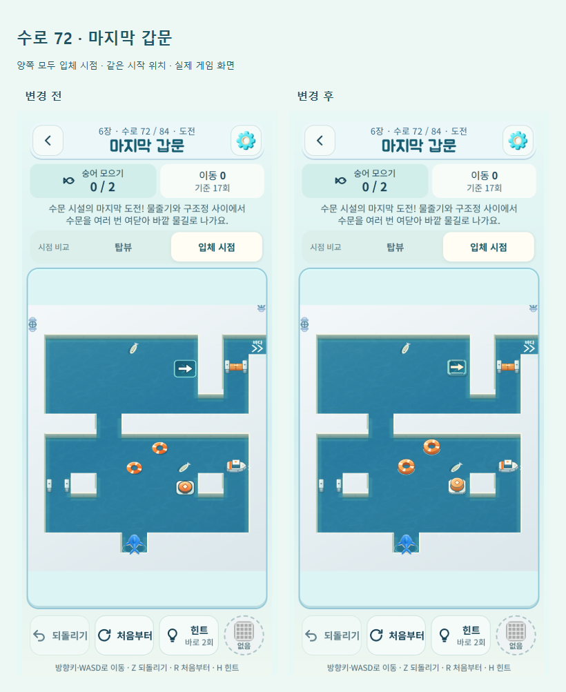

# 입체 시점의 부표·스위치·물줄기

2026-10-14. 변경 전 기준: `a3843ab`. [정식 게임](https://kongrae.github.io/bukang-sea/).

기존 입체 카메라에서는 부표와 물줄기의 평면 도형, 스위치의 탑뷰 SVG를 세로로 압축했다. 실제 72번 수로 화면에서도 앞서 개선한 구조정·수문에 비해 세 장치의 높이가 약했다. 입체 시점 전용 Canvas 그림을 추가해 같은 화면 위쪽 광원, 옆면 음영, 낮은 수면 그림자로 맞췄다.

| 장치 | 바뀐 그림 | 유지한 구분 |
|---|---|---|
| 부표 | 주황 튜브의 두꺼운 앞면·안쪽 벽·수면 가장자리 | 가운데로 물이 보이는 구멍과 네 개의 밝은 띠 |
| 스위치 | 밝은 받침 위 원통 버튼, 기존 누름 단계에 따른 높이 변화 | 꺼짐은 높은 주황 버튼과 마름모, 켜짐은 낮은 민트 버튼과 체크 |
| 물줄기 | 낮은 파란 수로 바닥과 양옆 테두리, 안쪽의 흐름 | 네 방향의 밝고 불투명한 고정 화살표 |

물줄기 테두리는 이동 방향을 가로막는 높은 벽으로 그리지 않는다. 화살표는 물의 흐름이나 활성 반짝임과 별도로 그려 방향을 계속 표시한다. 부표는 가운데가 비어 있고 스위치는 단단한 버튼이어서 주황색일 때도 형태가 다르다.

## 확인 위치와 전후 비교

메인 → 수로 선택 → **6장 수로 72 ‘마지막 갑문’ → 입체 시점**에서 세 장치를 함께 볼 수 있다. 이 수로에만 적용한 것이 아니라, 현재 정식 수로 84개 중 해당 장치가 있는 모든 입체 화면에 적용했다. 기존 해금 조건을 유지한다. 탑뷰 버튼을 누르면 기존 그림과 바로 비교할 수 있다. 일일·자유·이전 정의로 복원한 수로의 카메라 범위는 변경하지 않았다.

다음 확대 비교는 실제 게임의 그리기 함수를 같은 크기·상태로 호출한 결과다.



다음은 같은 시작 위치의 실제 게임 화면이다. Edge 390×844 모바일 에뮬레이션이며 후반 수로 접근에는 격리된 QA 진행 기록을 사용했다.



## 변경 범위

`src/game.js`의 `drawBuoy`, `drawSwitch`, `drawJet`에 기본값 false인 `raised` 인수를 추가했다. 기존 `draw()`에서 입체 카메라일 때만 true를 전달한다. 받침과 테두리는 구조정·상자·수문에 쓰는 `devicePrism()`을 재사용한다. 둥근 부표·버튼의 옆면은 Canvas 호로 그린다. 이미지 추가 다운로드나 라이브러리는 없다.

기존 접촉 크기 변화, 물줄기 활성 값, 스위치 누름 단계와 `reduceMotion`을 사용한다. 새 타이머나 렌더 루프를 만들지 않았다. 엔진·수로 정의·충돌·턴 순서·진행 저장·해금·보상 코드는 변경하지 않았다. 탑뷰와 장치 안내의 기본 호출은 이전 그림을 유지한다.

## 검증 결과

- `npm test`: 241/241 통과.
- `npm run verify`: 정식 84개 및 이전 시험 12개 수로의 해법·별 기준 통과.
- 변경 전후 정식 84개 맵 렌더링, 전체 시점 전환 확인. 대표 7개 수로의 실제 키보드/그물 포인터 입력 69회에서 게임 상태와 저장 세션이 완전히 일치했다. 이전 저장의 재시작 복원도 통과했다.
- 실제 Canvas 픽셀 검사: 부표 구멍은 물을 비추는 반투명 그림자만 남고 스위치는 불투명한 버튼으로 구분된다. 꺼짐/켜짐 높이가 다르며, 기존 누름 단계 전체에서 그리기 상태가 복원된다.
- 물줄기 네 방향에서 화살촉과 좁은 꼬리 방향을 검사했다. 정상 흐름과 활성 반짝임 중 화살표의 불투명한 픽셀이 같은 위치에 유지된다.
- 탑뷰·안내용 11개 표본이 이전 빌드와 픽셀 단위로 동일하다. 동작 줄이기에서 새 입체 장치의 t=0과 t=7 그림이 동일하다. 기존 수문의 개폐 두 축과 구조정 화살표 네 방향도 통과했다.
- 정식 UI에서 72/84번 수로 선택, 시점 변경 시 저장 바이트 유지, 새로고침·이어하기·되돌리기 확인. 320/360/390/430px, 200% 루트 글자 확대, 빠른 시점 전환, 서비스워커 오프라인 복원 통과.
- 이미지 실패 상태에서도 Canvas 장치 표시와 첫 화면 진입 확인.
- 단일 HTML, artifact, PWA 및 Capacitor Android debug APK 빌드 성공.

결과: [픽셀 검사](water-device-depth/pixel-checks.json), [규칙·저장 대조](water-device-depth/regression-checks.json), [정식 UI 검사](water-device-depth/browser-checks.json). 전체 원본과 상태 기록은 `outputs/qa/board-art/`, `outputs/qa/water-device-depth/`, `outputs/qa/device-view/`에 있다.

PC의 72번 반복 그리기 측정은 변경 전 중앙값 0.3ms, 변경 후 0.8ms였다. 이는 전체 프레임 성능이나 모바일 성능의 증거가 아니다. 실제 Android 기기의 시인성·터치·저사양 프레임은 미확인이다. 이번 검증의 글자 확대는 브라우저 CSS 확대이며 OS 글자 확대 검사가 아니다.

## 재현과 배포 확인

```text
npm test
npm run verify
npm run build
npm run build:artifact
npm run android:debug
node tools/serve.js . 5182
node tools/board-art-qa.js <기존 playwright 경로> a3843ab devices
node tools/device-depth-qa.js <기존 playwright 경로> water
node tools/device-view-qa.js <기존 playwright 경로>
```

`tools/deploy-pages.ps1`로 소스와 웹 빌드를 배포한다. 공개 `version.json.sourceCommit`, 본 게임과 비교판의 HTML/서비스워커 SHA-256을 배포 빌드와 대조한 후 공개 URL에서도 `device-view-qa.js`를 실행한다. QA 훅과 후반 해금 fixture는 출시 빌드에 포함하지 않는다.
